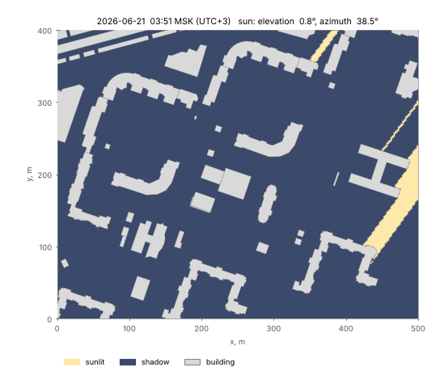
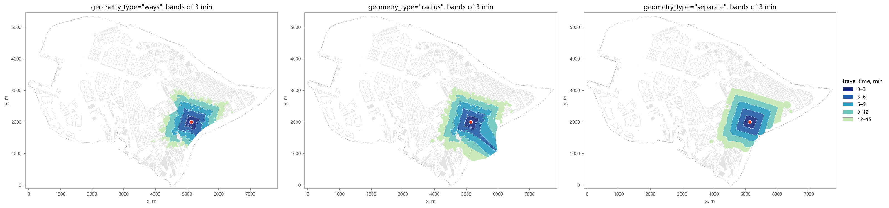
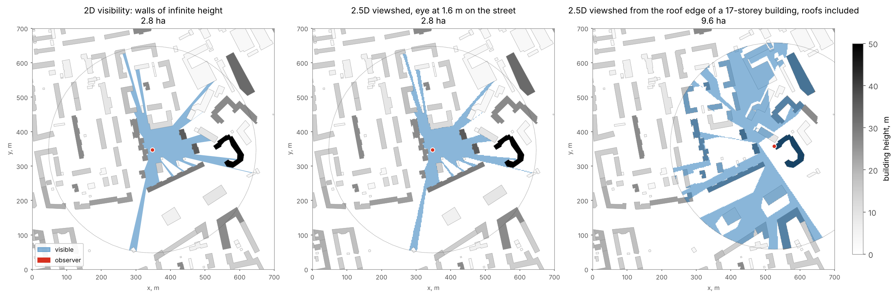
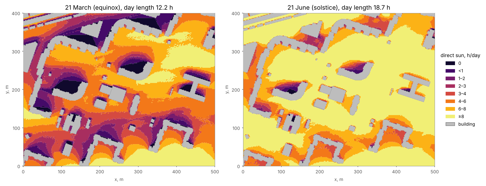

ObjectNat
=========

Object-oriented Network Analysis Tools
--------------------------------------

.. |badge-black| image:: https://img.shields.io/badge/code%20style-black-000000.svg
   :target: https://github.com/psf/black
   :alt: Code style: black

.. |badge-pypi| image:: https://img.shields.io/pypi/v/objectnat.svg
   :target: https://pypi.org/project/objectnat/
   :alt: PyPI version

.. |badge-ci| image:: https://github.com/IDUclub/ObjectNat/actions/workflows/quality.yml/badge.svg
   :target: https://github.com/IDUclub/ObjectNat/actions/workflows/quality.yml
   :alt: Tests and coverage

.. |badge-license| image:: https://img.shields.io/badge/license-BSD--3--Clause-blue.svg
   :target: https://opensource.org/licenses/BSD-3-Clause
   :alt: License

.. |badge-docs| image:: https://img.shields.io/badge/docs-latest-4aa0d5?logo=readthedocs
   :target: https://iduclub.github.io/ObjectNat/
   :alt: Docs

|badge-black| |badge-pypi| |badge-ci| |badge-coverage| |badge-license| |badge-docs|

`РИДМИ (Russian) <https://github.com/IDUclub/ObjectNat/blob/master/README_RU.rst>`__

.. image:: https://raw.githubusercontent.com/IDUclub/ObjectNat/master/docs/_static/ONlogo.svg
   :align: center
   :width: 400
   :alt: ObjectNat logo

**ObjectNat** is an open-source Python library for spatial analysis of urban objects (buildings, services,
street observers, noise sources), developed by the IDU team at ITMO University. It computes accessibility,
coverage and service provision on street graphs from `IduEdu <https://github.com/IDUclub/IduEdu>`__, visibility in
2D and over building heights, noise levels and insolation. Inputs and outputs are GeoPandas GeoDataFrames; the
computationally intensive parts run in a compiled Rust extension.

`Documentation <https://iduclub.github.io/ObjectNat/>`__ · `Examples <https://iduclub.github.io/ObjectNat/methods/examples/index.html>`__ ·
`Migration from 1.x <https://iduclub.github.io/ObjectNat/migration_1_to_2.html>`__

----

Methods
-------

**Isochrones** (`docs <https://iduclub.github.io/ObjectNat/methods/isochrones.html>`__, `example <https://iduclub.github.io/ObjectNat/methods/examples/isochrones.html>`__).
``get_graph_isochrones`` and ``get_stepped_graph_isochrones`` return the area reachable from origins within a
travel time (minutes) or network distance (metres) on an ``iduedu.UrbanGraph``, as one polygon per origin or as
bands of width ``step``. The polygon is built from residual-distance buffers around the reachable nodes
(``"radius"``), from the buffered reachable streets (``"ways"``) or from merged buffers (``"separate"``).

**Coverage zones** (`docs <https://iduclub.github.io/ObjectNat/methods/coverage.html>`__, `example <https://iduclub.github.io/ObjectNat/methods/examples/coverage.html>`__).
``get_graph_coverage`` and ``get_stepped_graph_coverage`` assign every place to the service it reaches at the lowest
network cost within a budget (search on the reversed graph, Voronoi cells of graph nodes), so zones do not overlap.
``get_radius_coverage`` is a graph-free variant with a fixed radius.

**Service provision** (`docs <https://iduclub.github.io/ObjectNat/methods/provision.html>`__, `example <https://iduclub.github.io/ObjectNat/methods/examples/provision.html>`__).
``get_service_provision`` allocates building demand to services with limited capacity using a gravity-based
probabilistic model over a dense or pandas-sparse cost matrix and a normative threshold. It returns a
``ProvisionResult`` with the sparse flow matrix and per-building and per-service metrics (``provision_value`` is the
share of demand supplied within the threshold); helpers join the metrics to GeoDataFrames, build link lines,
drop links beyond a shorter threshold and clip the result to an area.

**Visibility** (`docs <https://iduclub.github.io/ObjectNat/methods/visibility.html>`__, examples: `2D <https://iduclub.github.io/ObjectNat/methods/examples/visibility.html>`__,
`2.5D <https://iduclub.github.io/ObjectNat/methods/examples/viewshed.html>`__). ``get_visibility`` computes the exact visibility polygon (isovist) of
each observer among obstacles treated as walls of infinite height and, with ``isovist_metrics=True``, area,
compactness, occlusivity, radial statistics, drift and view share. ``get_viewshed`` uses building heights and
terrain: a grid cell is visible when the line of sight from the eye (1.6 m by default, or on a roof) to the cell
passes above every wall and the ground. ``get_visibility_catchment`` and ``get_viewshed_catchment`` count, for every
cell, the observers that see it (observers along streets come from ``get_observer_points``) and return zones of
equal visibility class.

**Noise** (`docs <https://iduclub.github.io/ObjectNat/methods/noise.html>`__, `example <https://iduclub.github.io/ObjectNat/methods/examples/noise.html>`__). ``simulate_noise_grid``
computes sound levels on a receiver grid from point, line and polygon sources: direct paths and first-order
reflections with geometric spreading, air absorption, wall absorption and vegetation attenuation, summed as energies.
``simulate_noise`` is a wave-front model for point sources with multiple reflections, and
``calculate_simplified_noise_frame`` a fast estimate from visibility masks and distance decay. Ground effect and
diffraction are not modelled. Background: `wiki <https://github.com/IDUclub/ObjectNat/wiki/Noise-simulation>`__.

**Insolation** (`docs <https://iduclub.github.io/ObjectNat/methods/insolation.html>`__, `example <https://iduclub.github.io/ObjectNat/methods/examples/insolation.html>`__).
``get_insolation`` follows the sun (NOAA solar position) through a day or a period and returns, on a ground grid
among buildings of known height and optional terrain (GeoDataFrame, GeoTIFF or array), zones of daily direct sun
hours, including ground with no direct sun. Receivers also carry the hours on the worst day and the longest
continuous sunlit period, which insolation norms restrict. ``get_facade_insolation`` computes the same quantities
for facade points on every floor and checks them against a norm.

----

Installation
------------

::

    pip install objectnat

ObjectNat supports Python 3.11–3.14 on Linux, macOS and Windows and installs IduEdu 2.2 or newer within the 2.x
series. Wheels include the compiled extension ``objectnat._rust``, so ``pip`` needs no compiler. Installing from a
source checkout (``pip install .``) builds the extension and requires a Rust toolchain
(`rustup <https://rustup.rs>`__). GeoTIFF terrain requires the optional ``rasterio`` package.

----

Street graphs from IduEdu
-------------------------

Graph-based methods take an ``iduedu.UrbanGraph`` (nodes and edges as GeoDataFrames, edge weights ``time_min`` and
``length_meter``) and use IduEdu's Dijkstra routines; ObjectNat does not build graphs itself. IduEdu 2.4 and newer
can download a Geofabrik extract and cut the territory out of it, so no Overpass request is needed (cutting needs
``pip install "iduedu[pbf]"``)::

    from iduedu import config, download_osm_pbf, get_4326_boundary, get_intermodal_graph

    pbf = download_osm_pbf(osm_id=1114252, region="northwestern-fed-district")
    with config.use_pbf(pbf):
        boundary = get_4326_boundary(osm_id=1114252)
        graph = get_intermodal_graph(territory=boundary, clip_by_territory=True)

Without the ``with`` block the same calls query the Overpass API.

----

Configuration
-------------

::

    from objectnat import config

    config.change_logger_lvl("INFO")   # hide debug messages
    config.set_enable_tqdm(False)      # disable progress bars

----

Contacts
--------

- `NCCR <https://actcognitive.org/>`_, National Center for Cognitive Research
- `IDU <https://idu.itmo.ru/>`_, Institute of Design and Urban Studies
- `Natalya Chichkova <https://t.me/nancy_nat>`_, project manager
- `Danila Oleynikov (Donny) <https://t.me/ddonny_dd>`_, lead software engineer

Contributions are described in `CONTRIBUTING.md <https://github.com/IDUclub/ObjectNat/blob/master/CONTRIBUTING.md>`__.

----

Citing ObjectNat
----------------

Citation metadata is kept in
`CITATION.cff <https://github.com/IDUclub/ObjectNat/blob/master/CITATION.cff>`__; on GitHub,
**Cite this repository** in the repository sidebar exports it as APA or BibTeX. Publications describing ObjectNat
will be listed here.
