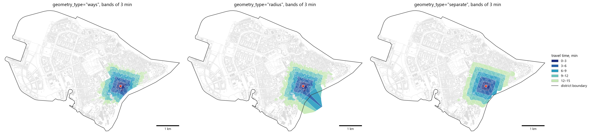
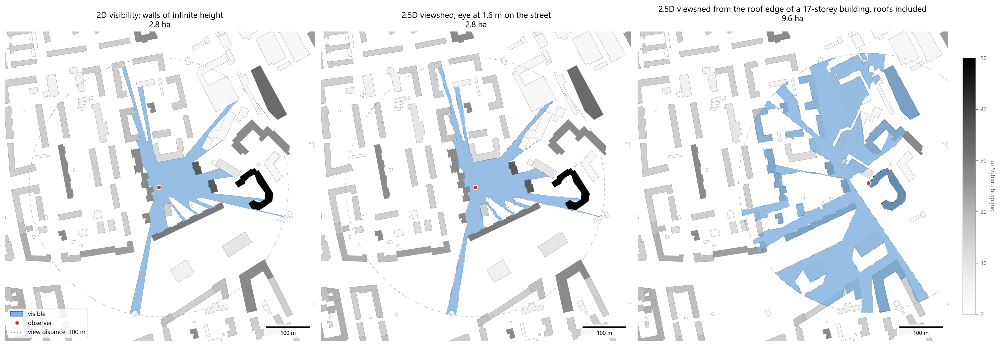
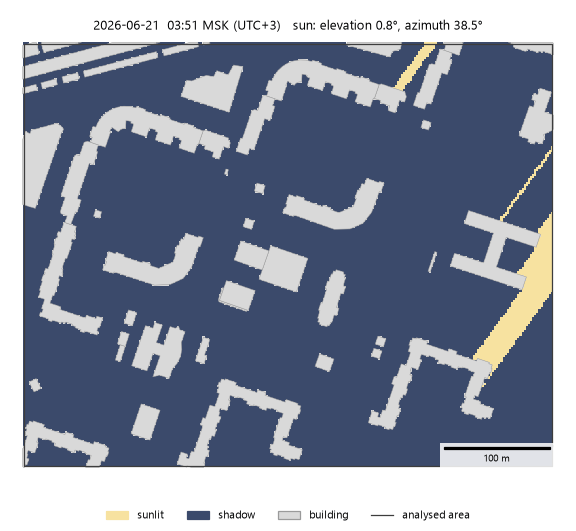

ObjectNat
=========

Object-oriented Network Analysis Tools
--------------------------------------

.. |badge-black| image:: https://img.shields.io/badge/code%20style-black-000000.svg
   :target: https://github.com/psf/black
   :alt: Стиль кода: black

.. |badge-pypi| image:: https://img.shields.io/pypi/v/objectnat.svg
   :target: https://pypi.org/project/objectnat/
   :alt: Версия PyPI

.. |badge-ci| image:: https://github.com/IDUclub/ObjectNat/actions/workflows/quality.yml/badge.svg
   :target: https://github.com/IDUclub/ObjectNat/actions/workflows/quality.yml
   :alt: Тесты и покрытие

.. |badge-license| image:: https://img.shields.io/badge/license-BSD--3--Clause-blue.svg
   :target: https://opensource.org/licenses/BSD-3-Clause
   :alt: Лицензия

.. |badge-docs| image:: https://img.shields.io/badge/docs-latest-4aa0d5?logo=readthedocs
   :target: https://iduclub.github.io/ObjectNat/
   :alt: Документация

|badge-black| |badge-pypi| |badge-ci| |badge-coverage| |badge-license| |badge-docs|

`README (English) <https://github.com/IDUclub/ObjectNat/blob/master/README.rst>`_

.. image:: https://raw.githubusercontent.com/IDUclub/ObjectNat/master/docs/_static/ONlogo.svg
   :align: center
   :width: 400
   :alt: ObjectNat logo

----

**ObjectNat** — библиотека Python с открытым исходным кодом для пространственного анализа городских объектов
(зданий, сервисов, наблюдателей на улицах, источников шума), разрабатываемая командой IDU Университета ИТМО.
Она рассчитывает доступность, зоны покрытия и обеспеченность сервисами на графах улиц из
`IduEdu <https://github.com/IDUclub/IduEdu>`__, видимость в 2D и с учётом высот зданий, уровни шума и
инсоляцию. Входные и выходные данные — GeoDataFrame библиотеки GeoPandas; ресурсоёмкие вычисления выполняются
в скомпилированном расширении на Rust.

`Документация <https://iduclub.github.io/ObjectNat/>`__ · `Примеры <https://iduclub.github.io/ObjectNat/methods/examples/index.html>`__

----

Методы
------

**Изохроны** (`документация <https://iduclub.github.io/ObjectNat/methods/isochrones.html>`__, `пример <https://iduclub.github.io/ObjectNat/methods/examples/isochrones.html>`__).
``get_graph_isochrones`` и ``get_stepped_graph_isochrones`` возвращают территорию, достижимую из точек отправления
за заданное время (мин) или сетевое расстояние (м) по графу ``iduedu.UrbanGraph``: один полигон на точку или
пояса шириной ``step``. Полигон строится по буферам остаточного расстояния вокруг достижимых узлов
(``"radius"``), по буферам достижимых улиц (``"ways"``) или по объединённым буферам (``"separate"``).

**Зоны покрытия** (`документация <https://iduclub.github.io/ObjectNat/methods/coverage.html>`__, `пример <https://iduclub.github.io/ObjectNat/methods/examples/coverage.html>`__).
``get_graph_coverage`` и ``get_stepped_graph_coverage`` относят каждое место к сервису, до которого сетевая
стоимость в пределах заданного бюджета минимальна (поиск по обращённому графу, ячейки Вороного узлов графа),
поэтому зоны не перекрываются. ``get_radius_coverage`` строит зоны без графа, по фиксированному радиусу.

**Обеспеченность сервисами** (`документация <https://iduclub.github.io/ObjectNat/methods/provision.html>`__,
`пример <https://iduclub.github.io/ObjectNat/methods/examples/provision.html>`__). ``get_service_provision`` распределяет спрос зданий между
сервисами с ограниченной вместимостью по гравитационной вероятностной модели на плотной или разреженной
(pandas sparse) матрице стоимостей с нормативным порогом. Результат — ``ProvisionResult`` с разреженной матрицей
потоков и показателями по зданиям и сервисам (``provision_value`` — доля спроса, обеспеченная в пределах порога).
Вспомогательные функции присоединяют показатели к GeoDataFrame, строят линии связей, удаляют связи длиннее
нового порога и обрезают результат по территории.

**Видимость** (`документация <https://iduclub.github.io/ObjectNat/methods/visibility.html>`__, примеры: `2D <https://iduclub.github.io/ObjectNat/methods/examples/visibility.html>`__,
`2.5D <https://iduclub.github.io/ObjectNat/methods/examples/viewshed.html>`__). ``get_visibility`` вычисляет точный полигон видимости (изовисту)
каждого наблюдателя среди препятствий, которые считаются стенами бесконечной высоты, а при
``isovist_metrics=True`` — площадь, компактность, окклюзивность, радиальные статистики, смещение центроида
(drift) и долю видимого круга. ``get_viewshed`` учитывает высоты зданий и рельеф: ячейка сетки видна, если луч
зрения от глаз наблюдателя (по умолчанию 1,6 м над землёй или над крышей) до ячейки проходит выше всех стен и
поверхности земли. ``get_visibility_catchment`` и ``get_viewshed_catchment`` подсчитывают для каждой ячейки
число наблюдателей, которые её видят (наблюдателей вдоль улиц размещает ``get_observer_points``), и возвращают
зоны одного класса видимости.

**Шум** (`документация <https://iduclub.github.io/ObjectNat/methods/noise.html>`__, `пример <https://iduclub.github.io/ObjectNat/methods/examples/noise.html>`__).
``simulate_noise_grid`` рассчитывает уровни звука в узлах сетки приёмников от точечных, линейных и площадных
источников: прямой путь и отражения первого порядка с учётом геометрического расхождения, поглощения в воздухе,
поглощения стенами и ослабления растительностью, а также дифракцию в тень за углами зданий, с энергетическим
суммированием. ``simulate_noise`` — волновая модель для точечных источников с многократными отражениями,
``calculate_simplified_noise_frame`` — быстрая оценка по маскам видимости и затуханию с расстоянием. Влияние
земли не моделируется.
Подробнее: `вики <https://github.com/IDUclub/ObjectNat/wiki/Noise-simulation>`__.

**Инсоляция** (`документация <https://iduclub.github.io/ObjectNat/methods/insolation.html>`__, `пример <https://iduclub.github.io/ObjectNat/methods/examples/insolation.html>`__).
``get_insolation`` прослеживает положение солнца (алгоритм NOAA) в течение дня или периода и возвращает для
сетки точек на земле среди зданий известной высоты и, при необходимости, рельефа (GeoDataFrame, GeoTIFF или
массив) зоны продолжительности прямого солнечного освещения в часах за сутки, включая участки, на которые прямое
солнце не попадает. Для точек также доступны часы в худший день и наибольшая непрерывная продолжительность
инсоляции, которую ограничивают нормативы. ``get_facade_insolation`` рассчитывает те же величины для точек на
фасадах по этажам и проверяет их по нормативу.

**Растры.** Результаты на регулярной сетке (приёмники инсоляции и шума, ячейки зон видимости, поля изовист из
``get_isovist_grid``) превращаются в растры функцией ``rasterize``: ``Raster`` можно нарисовать в matplotlib,
записать в GeoTIFF или показать на веб-карте folium методом ``explore``.

----

Установка
---------

::

    pip install objectnat

ObjectNat поддерживает Python 3.11–3.14 в Linux, macOS и Windows и устанавливает IduEdu версии 2.4.1 или новее
в пределах серии 2.x. Колёса (wheels) содержат скомпилированное расширение ``objectnat._rust``, поэтому
компилятор для ``pip`` не нужен. Установка из исходного кода (``pip install .``) собирает расширение и требует
инструментов Rust (`rustup <https://rustup.rs>`__). Для чтения рельефа из GeoTIFF нужен необязательный пакет
``rasterio``.

----

Графы улиц из IduEdu
--------------------

Методы, работающие с графом, принимают ``iduedu.UrbanGraph`` (узлы и рёбра в виде GeoDataFrame, веса рёбер
``time_min`` и ``length_meter``) и используют алгоритмы Дейкстры из IduEdu; ObjectNat сам графы не строит.
IduEdu загружает выгрузку Geofabrik и вырезает из неё территорию, поэтому запросы к Overpass не нужны
(для вырезания требуется ``pip install "iduedu[pbf]"``)::

    from iduedu import config, download_osm_pbf, get_4326_boundary, get_intermodal_graph

    pbf = download_osm_pbf(osm_id=1114252, region="northwestern-fed-district")
    with config.use_pbf(pbf):
        boundary = get_4326_boundary(osm_id=1114252)
        graph = get_intermodal_graph(territory=boundary, clip_by_territory=True)

Без блока ``with`` те же вызовы обращаются к Overpass API.

----

Настройка
---------

::

    from objectnat import config

    config.change_logger_lvl("INFO")   # скрыть отладочные сообщения
    config.set_enable_tqdm(False)      # отключить индикаторы выполнения

----

Контакты
--------

- `НЦКР <https://actcognitive.org/>`_ — Национальный центр когнитивных исследований
- `ИДУ <https://idu.itmo.ru/>`_ — Институт дизайна и урбанистики
- `Наталья Чичкова <https://t.me/nancy_nat>`_ — руководитель проекта
- `Данила Олейников (Donny) <https://t.me/ddonny_dd>`_ — ведущий инженер-программист

Порядок участия в разработке описан в
`CONTRIBUTING.md <https://github.com/IDUclub/ObjectNat/blob/master/CONTRIBUTING.md>`__.

----

Цитирование
-----------

Метаданные для цитирования находятся в
`CITATION.cff <https://github.com/IDUclub/ObjectNat/blob/master/CITATION.cff>`__; на GitHub кнопка
**Cite this repository** на боковой панели репозитория выдаёт их в формате APA или BibTeX. Публикации об ObjectNat
будут перечислены здесь.
