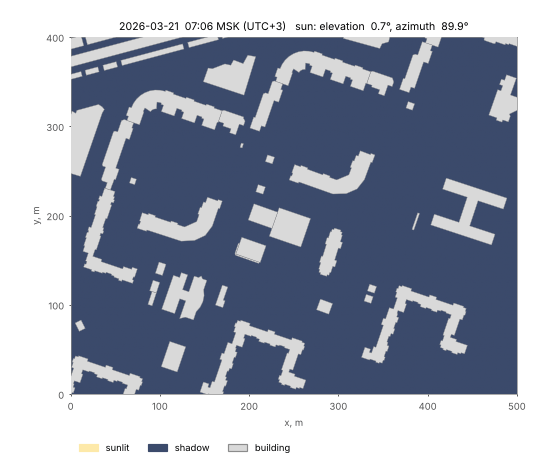

.. toctree::
    :hidden:
    :maxdepth: 1

    methods/isochrones
    methods/coverage
    methods/provision
    methods/visibility
    methods/noise
    methods/insolation
    methods/examples/index
    migration_1_to_2

ObjectNat
=========

Object-level network and spatial analysis for cities
----------------------------------------------------

**ObjectNat** is an open-source Python library for spatial analysis of urban objects: buildings, services, street
observers and noise sources. It is developed by the IDU team at ITMO University.

|badge-black| |badge-pypi| |badge-ci| |badge-cov| |badge-license| |badge-github|

.. |badge-black| image:: https://img.shields.io/badge/code%20style-black-000000.svg
   :target: https://github.com/psf/black
   :alt: Code style: black

.. |badge-pypi| image:: https://img.shields.io/pypi/v/objectnat.svg
   :target: https://pypi.org/project/objectnat/
   :alt: PyPI version

.. |badge-ci| image:: https://github.com/IDUclub/ObjectNat/actions/workflows/quality.yml/badge.svg
   :target: https://github.com/IDUclub/ObjectNat/actions/workflows/quality.yml
   :alt: Tests and coverage

.. |badge-license| image:: https://img.shields.io/badge/license-BSD--3--Clause-blue.svg
   :target: https://opensource.org/licenses/BSD-3-Clause
   :alt: License

.. |badge-github| image:: https://img.shields.io/badge/GitHub-IDUclub%2FObjectNat-181717?logo=github
   :target: https://github.com/IDUclub/ObjectNat
   :alt: GitHub

----

Overview
--------

ObjectNat works with GeoPandas data and with street graphs (``iduedu.UrbanGraph``) built by
`IduEdu <https://github.com/IDUclub/IduEdu>`__ from OpenStreetMap and GTFS. Every method page describes what is
computed, the algorithm, the parameters and outputs with units, an example figure and the limitations.

.. list-table::
   :header-rows: 1
   :widths: 24 46 30

   * - Method
     - Result
     - Functions
   * - :doc:`methods/isochrones`
     - Area reachable from origins within a time (min) or distance (m) budget on a graph
     - :func:`~objectnat.get_graph_isochrones`, :func:`~objectnat.get_stepped_graph_isochrones`
   * - :doc:`methods/coverage`
     - Non-overlapping zones served by each service within a budget
     - :func:`~objectnat.get_graph_coverage`, :func:`~objectnat.get_stepped_graph_coverage`,
       :func:`~objectnat.get_radius_coverage`
   * - :doc:`methods/provision`
     - Allocation of building demand to services with capacity under a cost threshold
     - :func:`~objectnat.get_service_provision` and helpers
   * - :doc:`methods/visibility`
     - Visibility polygons and isovist metrics (2D), viewsheds over building heights and terrain (2.5D), catchment
       zones of many observers
     - :func:`~objectnat.get_visibility`, :func:`~objectnat.get_viewshed`,
       :func:`~objectnat.get_visibility_catchment`, :func:`~objectnat.get_viewshed_catchment`
   * - :doc:`methods/noise`
     - Sound levels (dB) around point, line and polygon sources among obstacles and vegetation
     - :func:`~objectnat.simulate_noise_grid`, :func:`~objectnat.simulate_noise`,
       :func:`~objectnat.calculate_simplified_noise_frame`
   * - :doc:`methods/insolation`
     - Direct sun hours on the ground and on facades per floor, for a day or a period
     - :func:`~objectnat.get_insolation`, :func:`~objectnat.get_facade_insolation`

The computationally intensive parts (exact visibility, 2.5D lines of sight, insolation, receiver-grid noise and
provision allocation) run in a compiled Rust extension, ``objectnat._rust``, multi-threaded; graph searches use
IduEdu's Numba-accelerated Dijkstra routines. :doc:`methods/examples/index` holds an executable notebook for every
method.

   Ground shadows on 21 March 2026, 15-minute frames, computed with the insolation kernel.

----

Installation
------------

::

   pip install objectnat

ObjectNat supports Python 3.11–3.14 on Linux, macOS and Windows and installs IduEdu 2.2 or newer within the 2.x
series. Wheels contain the compiled extension, so ``pip`` needs no compiler; building from a source checkout requires
a Rust toolchain (`rustup <https://rustup.rs>`__). Reading GeoTIFF terrain for insolation and viewsheds requires the
optional ``rasterio`` package.

----

Quickstart
----------

Graph-based methods take an ``iduedu.UrbanGraph``. IduEdu 2.4 and newer can download a Geofabrik extract, cut the
territory out of it and build the graph from the local file instead of the Overpass API (cutting needs
``pip install "iduedu[pbf]"``):

.. code-block:: python

   import geopandas as gpd
   from iduedu import config, download_osm_pbf, get_4326_boundary, get_intermodal_graph
   from shapely.geometry import Point

   from objectnat import get_stepped_graph_isochrones

   # Vasilyevsky Island district, Saint Petersburg (OSM relation 1114252)
   pbf = download_osm_pbf(osm_id=1114252, region="northwestern-fed-district")
   with config.use_pbf(pbf):
       boundary = get_4326_boundary(osm_id=1114252)
       graph = get_intermodal_graph(territory=boundary, clip_by_territory=True)

   origins = gpd.GeoDataFrame(geometry=[Point(30.2706, 59.9355)], crs=4326)
   bands = get_stepped_graph_isochrones(
       graph,
       gdf_origins=origins,
       weight_type="time_min",
       weight_value_cutoff=10,  # minutes
       step=2,
       geometry_type="separate",
   )

Without ``download_osm_pbf`` (older IduEdu) the same calls without the ``with`` block query the Overpass API.

Methods that need no graph take GeoDataFrames directly, for example sun hours among buildings with a storeys column:

.. code-block:: python

   from objectnat import get_insolation

   zones = get_insolation(buildings, "2026-06-21", height_column=None, storeys_column="storeys_count")

Configuration
-------------

.. code-block:: python

   from objectnat import config

   config.change_logger_lvl("INFO")  # hide debug messages
   config.set_enable_tqdm(False)     # disable progress bars

----

Contributing, contacts and citation
-----------------------------------

Issues and pull requests are welcome on `GitHub <https://github.com/IDUclub/ObjectNat>`__; the workflow is described
in ``CONTRIBUTING.md``. Upgrading from ObjectNat 1.x is described in :doc:`migration_1_to_2`.

- `NCCR <https://actcognitive.org/>`_, National Center for Cognitive Research
- `IDU <https://idu.itmo.ru/>`_, Institute of Design and Urban Studies
- `Natalya Chichkova <https://t.me/nancy_nat>`_, project manager
- `Danila Oleynikov (Donny) <https://t.me/ddonny_dd>`_, lead software engineer

ObjectNat is distributed under the BSD 3-Clause license (``LICENSE.txt``). To cite it, use the metadata in
`CITATION.cff <https://github.com/IDUclub/ObjectNat/blob/master/CITATION.cff>`__ (on GitHub, **Cite this repository**
exports it as APA or BibTeX). Publications describing ObjectNat will be listed here.
