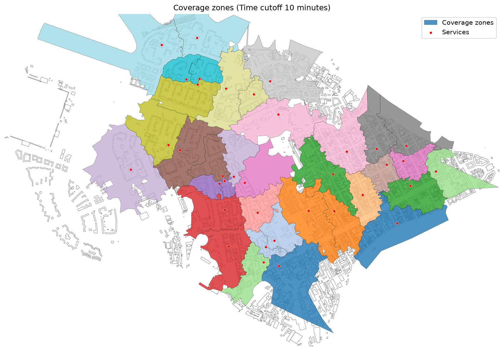
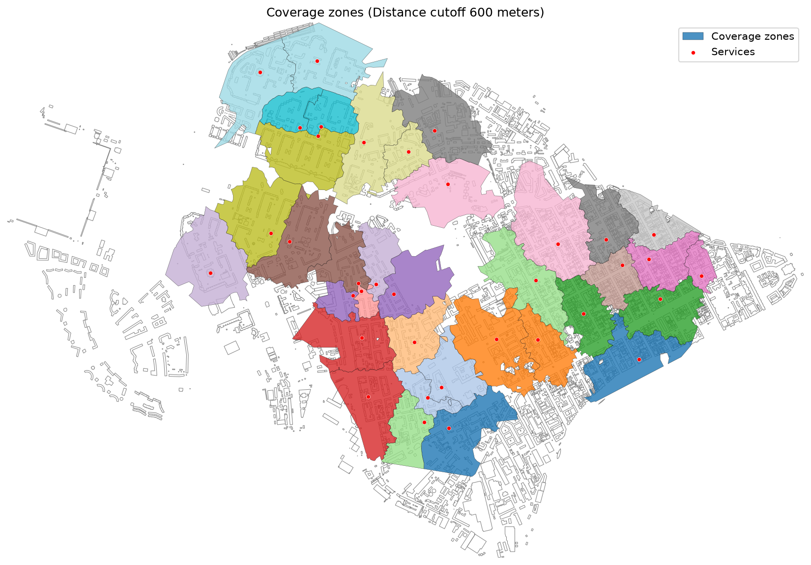
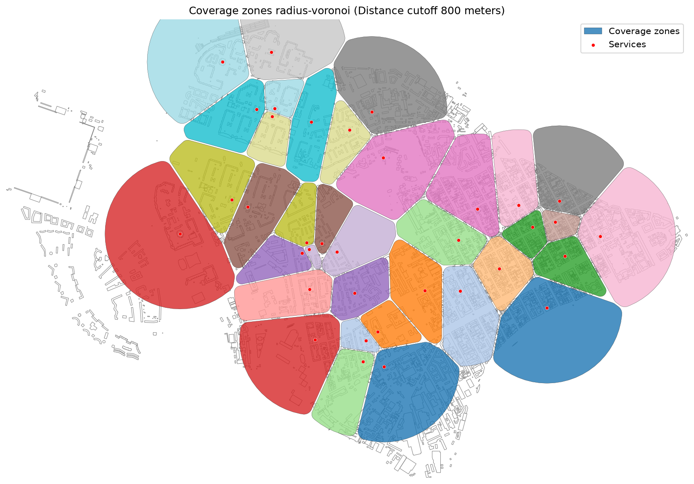
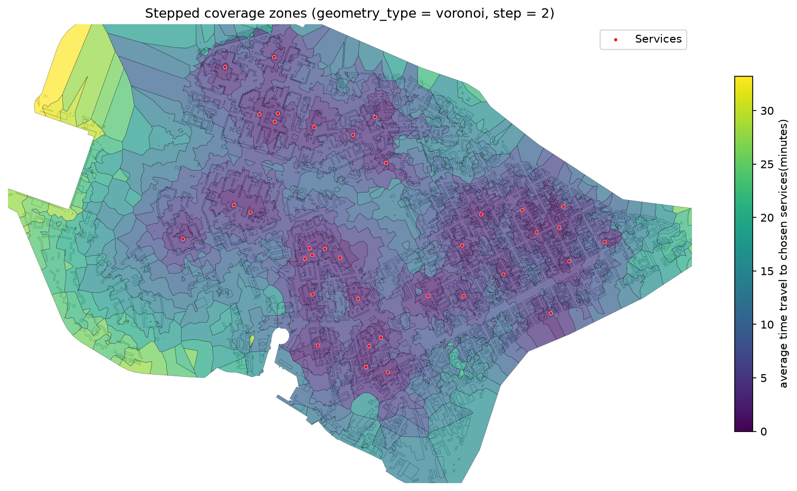
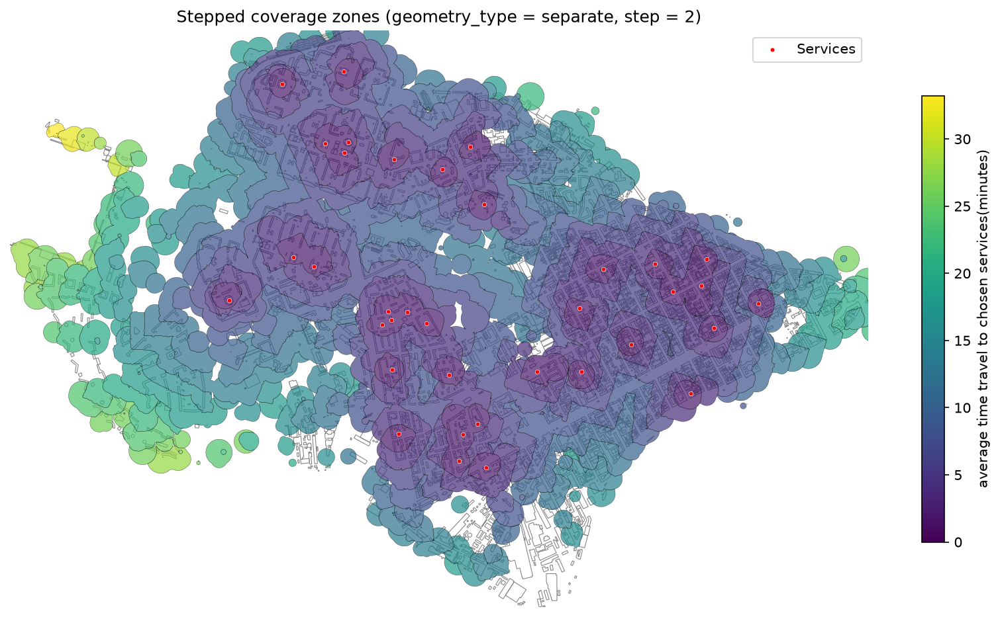

Coverage Zones
==============

Overview
--------

A **coverage zone** is the area served by one service (a destination) within a travel-time or distance budget,
where each place is assigned to the service that is closest along the network. Coverage differs from an isochrone in
two respects: the network search runs **towards** the services (on the reversed graph), and zones of different
services do not overlap.

- :func:`objectnat.get_graph_coverage` builds one zone per service on an ``iduedu.UrbanGraph``;
- :func:`objectnat.get_stepped_graph_coverage` splits the covered area into bands of width ``step``;
- :func:`objectnat.get_radius_coverage` is a graph-free variant: a Voronoi partition of the services limited by a
  fixed radius.

Method
------

1. Every service is snapped to its nearest graph node, or node ids are taken from ``graph_node_column`` or
   ``destination_nodes``.
2. A multi-source Dijkstra search runs on the reversed graph from all services at once, so every node is labelled
   with the service it reaches at the lowest cost (``time_min`` in minutes or ``length_meter`` in metres) within
   ``weight_value_cutoff``.
3. Voronoi cells are built around the graph nodes, and the cells of the nodes labelled with one service are
   dissolved into its zone.
4. The zones are clipped to ``zone`` (for example, a city boundary) or, without it, to the concave hull of the
   reachable nodes. ``geometry_type="radius"`` additionally clips them to buffers of the residual distance around the
   reachable nodes, and ``geometry_type="ways"`` to the buffered streets inside these buffers. For ``time_min`` the
   residual time is converted to a distance with the median edge speed of the graph.

On walk and intermodal graphs only pedestrian (``type == "walk"``) edges shape ``"ways"``, and only their end nodes
shape any geometry, as for isochrones.

Stepped coverage labels every node with the cost to its nearest service and builds one geometry per cost interval
of width ``step``: Voronoi cells (``geometry_type=None``), cells clipped to residual-radius buffers or streets (``"radius"``,
``"ways"``) or independent buffers (``"separate"``).

:func:`objectnat.get_radius_coverage` reprojects the services to a local UTM zone, builds their Voronoi polygons,
clips them to the union of ``radius``-metre buffers around the services and smooths every polygon by an inward
buffer followed by a slightly smaller outward buffer, both proportional to the cube root of the polygon area. The
smoothing rounds the corners, so zones can be slightly smaller than the clipped Voronoi cells.

Outputs
-------

:func:`objectnat.get_graph_coverage` and :func:`objectnat.get_radius_coverage` return one polygon per service,
indexed like the input services (join service attributes back by index).
:func:`objectnat.get_stepped_graph_coverage` returns polygons with the column ``dist`` (upper bound of the interval,
in minutes or metres). All results are in the CRS of the input services.

.. autofunction:: objectnat.get_graph_coverage

.. autofunction:: objectnat.get_stepped_graph_coverage

.. autofunction:: objectnat.get_radius_coverage

Figures
-------

   Coverage zones of the example services within 10 minutes on the intermodal graph.

   Coverage zones within 600 m of network distance.

   Graph-free coverage zones of :func:`objectnat.get_radius_coverage`, ``radius=800``.

   Stepped coverage zones, ``geometry_type=None``.

   Stepped coverage zones, ``geometry_type="separate"``.

Limitations
-----------

- Each place is assigned to one service, the one with the lowest network cost; capacity is not considered. Use
  :doc:`provision` to allocate demand under capacity limits.
- Zone outlines between network nodes come from Voronoi cells and residual-distance buffers, not from the street
  layout; their accuracy depends on the density of graph nodes.
- :func:`objectnat.get_radius_coverage` ignores the network and barriers such as rivers or railways.

Example notebook
----------------

:doc:`examples/coverage`
