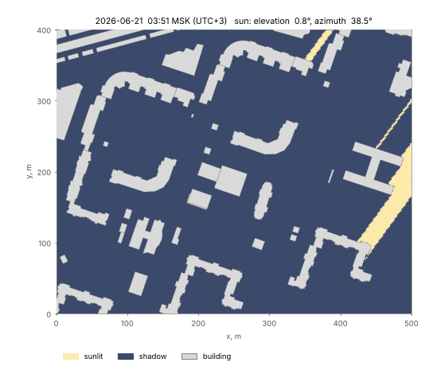
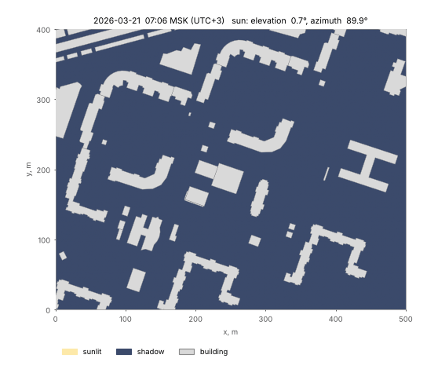
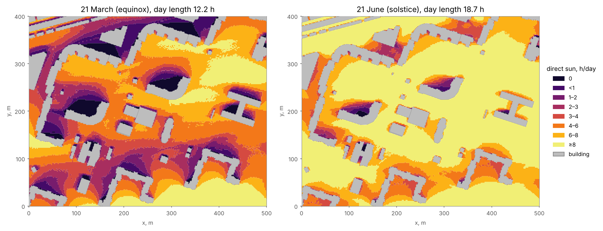
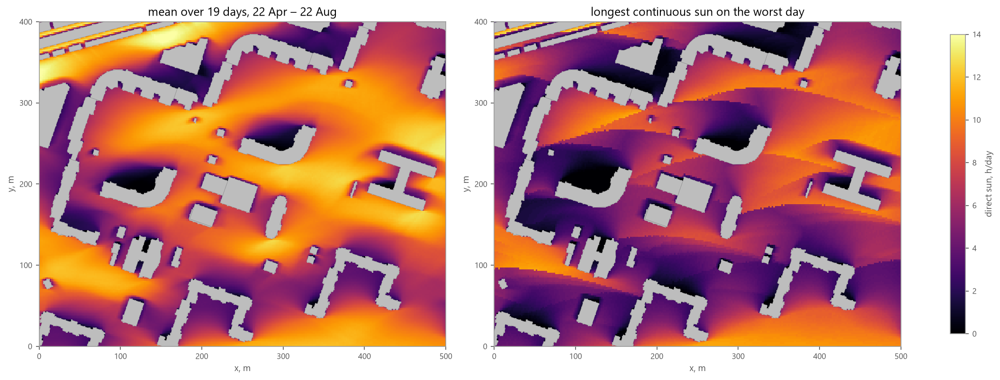
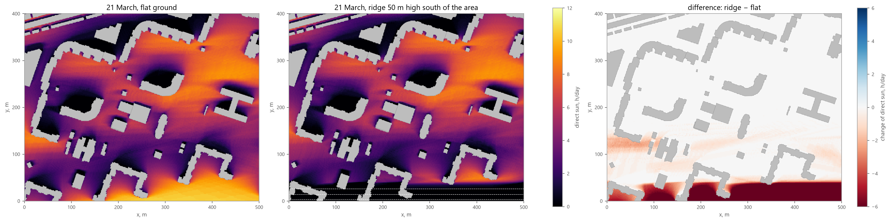
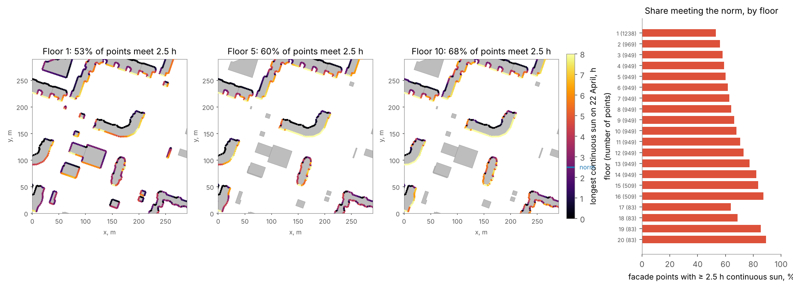

Insolation
==========

Overview
--------

Insolation analysis estimates how long a place receives direct sunlight among buildings of known height and,
optionally, terrain. :func:`objectnat.get_insolation` computes the daily **sun hours** on a regular grid of
ground receivers; :func:`objectnat.get_facade_insolation` computes them for facade points on every floor of the
selected buildings. Both functions accept a single day or a period. Typical uses are checks of insolation norms for
playgrounds and dwellings, comparison of development scenarios, and the placement of planting that needs direct
sun.

   Sunlit and shaded ground on 21 June 2026 in the example district (Vasilyevsky Island, Saint Petersburg,
   59.96° N), one frame every 15 minutes from sunrise to sunset. The title gives Moscow time (UTC+3) and the sun
   elevation and azimuth.

   The same district on 21 March 2026, the equinox.

Method
------

**Sun position.** For every simulated day the sun position is sampled every ``time_step_min`` minutes (the
midpoints of the intervals of a local solar day) with the NOAA solar position algorithm, including atmospheric
refraction; the stated accuracy of the algorithm is about 0.01°. The date and the centre of the area determine the
sun path, so latitude and season are taken into account. Positions below ``min_sun_elevation`` (degrees) count as
no sun.

**Scene.** Buildings are extruded footprints with flat roofs. The height of a building is taken from
``height_column``; where it is missing, from ``storeys_column`` × ``storey_height``; where both are missing, from
``default_height``. Buildings with no height at all are skipped with a warning. Terrain is optional and can be
given as

- a GeoDataFrame of polygons with heights in ``terrain_height_column`` (for example, elevation zones), rasterized
  with ``terrain_cell`` cells; overlapping polygons take the highest value;
- a path to a GeoTIFF (requires ``rasterio``);
- a tuple ``(heights, transform, crs)`` with a 2-D array, a north-up affine transform in rasterio order and a
  projected CRS.

Buildings stand on the terrain at their footprint, and receivers lie on the terrain at ``receiver_height`` above it.
The calculation runs in a local metric CRS (the raster CRS when a raster is given, otherwise an estimated UTM zone).
Azimuths are measured from true north; the difference between true north and grid north (meridian convergence) is
applied.

**Shadow test.** For every receiver and every sun position a ray is cast towards the sun. The receiver is sunlit
when the ray passes above every building wall it crosses and above the terrain. The ray is followed only while it is
lower than the highest roof or terrain point of the scene, so high sun positions are cheap. The test runs in
ObjectNat's Rust extension in parallel over receivers.

**Day statistics.** For each receiver and day the kernel returns the number of sunlit time steps and the longest
uninterrupted sunlit run. These give three quantities, all in hours:

- ``sun_hours``: mean daily direct sun over the simulated days;
- ``min_sun_hours``: direct sun on the worst simulated day;
- ``max_continuous_hours``: the longest continuous sunlit period on the worst day (the minimum over days of the
  daily longest run). Insolation norms usually restrict this quantity; SanPiN 1.2.3685-21 (Russia), for example,
  sets continuous insolation for dwellings and playgrounds.

Time steps are discrete, so every value is a multiple of ``time_step_min``.

**Periods.** ``date=("2026-04-22", "2026-08-22")`` simulates every ``day_step``-th day of the period and its last
day; the scene is built once.

Ground insolation
-----------------

:func:`objectnat.get_insolation` places receivers every ``grid_step`` metres inside ``area`` (by default the
bounding box of the buildings), outside building footprints. Include the buildings around the area in
``buildings``: their shadows reach into it.

The result is a GeoDataFrame of zones, one (Multi)Polygon per class of mean daily sun hours, with the class bounds
``sun_hours_min`` and ``sun_hours_max`` (``inf`` for the last class) and a text ``label``. ``hour_breaks`` sets the
bounds (default 1, 2, 3, 4, 6 and 8 h). Class ``0`` is ground that receives no direct sun on any simulated day.
``output="receivers"`` returns the receiver points with ``sun_hours``, ``min_sun_hours`` and
``max_continuous_hours`` instead of the zones, and ``output="both"`` returns both. Without zones the calculation is
faster: building the zone polygons takes most of the time of a single day. ``attrs`` of both results hold the simulated
``days`` and ``day_length_hours``, the mean time the sun is above ``min_sun_elevation``.
:func:`objectnat.rasterize` turns any receiver column into a raster for maps, GeoTIFF files and web maps (see
:doc:`rasters`).

.. autofunction:: objectnat.get_insolation

   Classes of direct sun hours on 21 March and 21 June 2026 in a 500 × 400 m area, ``grid_step=2``,
   ``time_step_min=10``. Building heights are ``storeys_count`` × 3 m.

   Period 22 April – 22 August 2026 with ``day_step=7`` (19 simulated days), receivers rasterized with
   :func:`objectnat.rasterize` on one scale. Left: mean daily sun hours. Right: longest continuous sunlit period on
   the worst day.

   The same area on 21 March on flat ground and with a synthetic ridge running west–east, 50 m high, its crest
   50 m south of the area, given as a ``(heights, transform, crs)`` array (dashed contours in metres). The low
   equinox sun comes from the south: the southern 40 m of the area, at the foot of the ridge, lose 7 h a day on
   average and two thirds of them get no direct sun at all; up to 180 m further north some places still lose 1–2
   h. A hill under the area itself changes little, because buildings and receivers rise with the ground.

Facade insolation
-----------------

:func:`objectnat.get_facade_insolation` places points along every wall of the buildings that intersect ``area``
(outer and courtyard walls) every ``spacing`` metres, 0.1 m in front of the wall, on every floor at
``window_height`` above the floor level. Walls shared with a neighbouring building get no points. The number of
floors is the storeys value when given, otherwise the height divided by ``storey_height``. A point counts the sun
only while the sun is in front of its facade, at least ``min_facade_angle`` degrees (horizontal) away from the
facade plane, and the ray towards the sun is not blocked by other buildings or the terrain. All buildings in
``buildings`` cast shadows, including those outside ``area``.

The result has one point per wall position and floor with ``building`` (index label of the building), ``floor``
(1 is the ground floor), ``height`` above the ground, ``facade_azimuth`` (direction the facade faces, degrees
clockwise from true north), ``sun_hours``, ``min_sun_hours`` and ``max_continuous_hours``. With ``norm_hours`` it
also has ``meets_norm`` (``max_continuous_hours >= norm_hours``). Grouping the points by ``building`` and
``floor`` shows which floors and facades fail a norm; comparing runs with and without a planned building shows
which windows it shades.

.. autofunction:: objectnat.get_facade_insolation

   Facade points (``spacing=3``) on 22 April 2026 coloured by the longest continuous sunlit period, for floors 1,
   5 and 10, and the share of points with at least 2.5 h of continuous sun per floor (``norm_hours=2.5``). The
   number of points per floor is given in brackets. The 2.5 h threshold is an example value; use the norm and the
   calculation day that apply to the project.

Limitations
-----------

- Roofs are flat. Pitched roofs, balconies, loggias, eaves and trees are not modelled.
- Facade points lie in front of the outer wall surface; window reveals (the wall depth) are not modelled, so the
  sun angles that a deep window opening would cut off still count, unless ``min_facade_angle`` excludes them.
- Only direct sunlight is counted. Diffuse sky light, reflected light and cloud cover are not.
- Results are discrete in time (``time_step_min``) and space (``grid_step``, ``spacing``); a continuous period can
  be under- or overestimated by up to one time step at each end.
- The accuracy of the result is limited by the building heights: heights derived from storey counts (``storeys``
  × ``storey_height``) can differ from surveyed heights by several metres.

Example notebook
----------------

:doc:`examples/insolation`
