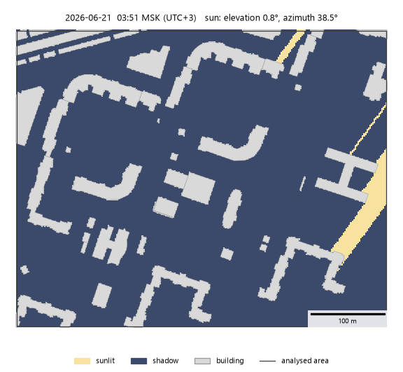
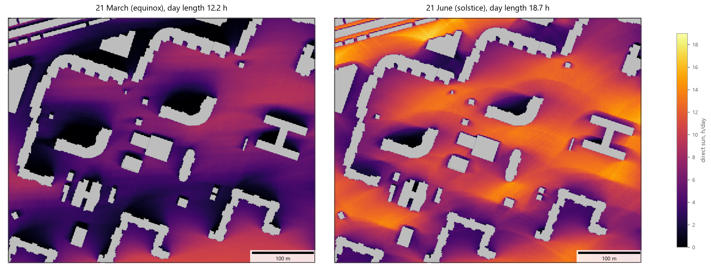
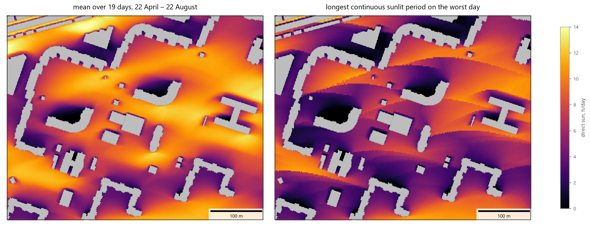
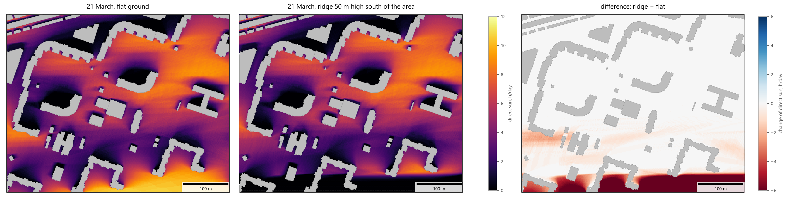
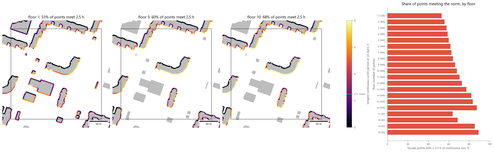

Insolation
==========

Overview
--------

Insolation analysis estimates how long a place receives direct sunlight among buildings of known height and,
optionally, terrain. :func:`objectnat.get_insolation` computes the daily **sun hours** on a regular grid of
ground receivers; :func:`objectnat.get_facade_insolation` computes them for facade points on every floor of the
selected buildings. Both functions accept a single day or a period. Typical uses are checks of insolation norms for
playgrounds and dwellings, comparison of development scenarios, and the placement of planting that needs direct
sun.

   Sunlit and shaded ground on 21 June 2026 in the example district (Vasilyevsky Island, Saint Petersburg,
   59.96° N), one frame every 15 minutes from sunrise to sunset. The title gives Moscow time (UTC+3) and the sun
   elevation and azimuth.

Method
------

**Sun position.** For every simulated day the sun position is sampled every ``time_step_min`` minutes (the
midpoints of the intervals of a local solar day) with the NOAA solar position algorithm, including atmospheric
refraction; the stated accuracy of the algorithm is about 0.01°. The date and the centre of the area determine the
sun path, so latitude and season are taken into account. Positions below ``min_sun_elevation`` (degrees) count as
no sun.

**Scene.** Buildings are extruded footprints with flat roofs. The height of a building is taken from
``height_column``; where it is missing, from ``storeys_column`` × ``storey_height``; where both are missing, from
``default_height``. Buildings with no height at all are skipped with a warning. Terrain is optional and can be
given as

- a GeoDataFrame of polygons with heights in ``terrain_height_column`` (for example, elevation zones), rasterized
  with ``terrain_cell`` cells; overlapping polygons take the highest value;
- a path to a GeoTIFF (requires ``rasterio``);
- a tuple ``(heights, transform, crs)`` with a 2-D array, a north-up affine transform in rasterio order and a
  projected CRS.

Buildings stand on the terrain at their footprint, and receivers are placed ``receiver_height`` above the terrain.
The calculation runs in a local metric CRS (the raster CRS when a raster is given, otherwise an estimated UTM zone).
Azimuths are measured from true north and corrected for the difference between true north and grid north
(meridian convergence).

**Shadow test.** For every receiver and every sun position a ray is cast towards the sun. The receiver is sunlit
when the ray passes above every building wall it crosses and above the terrain. The ray is followed only while it is
lower than the highest roof or terrain point of the scene, so rays towards a high sun end early and cost little. The test runs in
ObjectNat's Rust extension in parallel over receivers.

**Day statistics.** For each receiver and day the Rust extension returns the number of sunlit time steps and the
longest uninterrupted sunlit run. These give three quantities, all in hours:

- ``sun_hours``: mean daily direct sun over the simulated days;
- ``min_sun_hours``: direct sun on the worst simulated day;
- ``max_continuous_hours``: the longest continuous sunlit period on the worst day (the minimum over days of the
  daily longest run). Insolation norms usually set a minimum for this quantity; SanPiN 1.2.3685-21 (Russia), for
  example, sets the minimum continuous insolation of dwellings and playgrounds.

Time steps are discrete, so every value is a multiple of ``time_step_min``.

**Periods.** ``date=("2026-04-22", "2026-08-22")`` simulates every ``day_step``-th day of the period and its last
day; the scene is built once.

Building details from OSM
-------------------------

Set ``building_details=True`` in either insolation function to read optional Simple 3D Buildings (S3DB)
columns: ``building:part``, ``height``, ``min_height``, ``building:levels``, ``building:min_level``,
``roof:shape``, ``roof:height``, ``roof:levels``, ``roof:angle``, ``roof:direction`` and ``roof:orientation``.
Missing columns mean no data. Numeric values accept units, decimal commas and semicolon lists (the first
number is used). Roof directions accept degrees or the 16 compass points and are corrected from true to grid
north; ``roof:orientation="across"`` turns the default ridge across the longer footprint side.

Outlines containing parts are replaced by those parts; any uncovered remainder stays a flat volume
with the outline's height. An isolated part remains a volume of its own.
Parts with neither ``height`` nor ``building:levels`` inherit the parent outline height or levels;
if the parent has neither, the part's configured height fallbacks apply. Bottom and roof tags are not inherited.
``height`` includes the roof; ``building:levels`` excludes it. The bottom is ``min_height`` or
``building:min_level`` times ``storey_height``. Roof height is ``roof:height``, then ``roof:levels`` times
``storey_height``, then the slope from ``roof:angle`` or ``default_roof_angle=30.0`` and the footprint width.
The slope uses half the shorter side of the minimum rotated rectangle (the full shorter side for skillion).
Volumes stand on terrain sampled at their representative points. Heights are clamped to keep the eave between
the bottom and top; volumes with no height above their bottom are skipped with a counted warning.

Flat, skillion, gabled, hipped, pyramidal and cone roofs, building parts and raised parts with flat undersides
are modelled exactly. Dome, onion, half-dome and round use planar facets. Half-hipped, side_hipped,
quadruple_saltbox and mansard use hipped; gambrel and saltbox use gabled; many and unknown shapes use flat.
Holed or non-star-shaped apex roofs use hipped. Invalid hipped meshes fall back to gabled; approximations and
fallbacks are counted in a warning. Balconies, loggias, eaves overhangs, dormers, chimneys, parapets and sloped
undersides are not modelled.

Ground receivers below raised volumes are retained, so archways can receive sun. Facade points follow the
volume boundary, including gables, and only occupy heights between the bottom and the local wall top.
Points inside another volume at the same height are removed. Facade output uses ``building`` for the parent
outline label and adds ``part`` for the input volume row label; floors remain measured from the base ground.

.. code-block:: python

   import geopandas as gpd
   from objectnat import get_insolation, get_facade_insolation

   buildings = gpd.read_parquet("examples/examples_data/buildings_osm3d.parquet")
   receivers = get_insolation(
       buildings, "2026-06-21", building_details=True, default_height=12.0,
       default_roof_angle=30.0,
   )
   windows = get_facade_insolation(
       buildings, "2026-06-21", building_details=True, default_height=12.0,
   )

With ``building_details=False`` (the default), the original flat-roof calculation and output columns are retained.

Trees
-----

Both :func:`objectnat.get_insolation` and :func:`objectnat.get_facade_insolation` accept an optional
``trees`` GeoDataFrame, with either value of ``building_details``. Its CRS may differ from the buildings'.
Point/MultiPoint geometries describe individual trees. LineString/MultiLineString geometries become centred
rows with ``tree_spacing`` between trunks (by default, the feature's crown diameter), leaving at least half
a spacing at either end; a shorter line gets one tree at its midpoint. Polygon/MultiPolygon geometries become
a hexagonal lattice with that spacing, clipped to the polygon and its holes. Small polygons with no lattice
points receive one tree at their representative point. Unsupported geometry types are skipped with a warning.

Optional OSM columns are ``height`` (or ``est_height``), ``diameter_crown``, ``leaf_type`` and ``leaf_cycle``.
Numeric tags accept units, decimal commas and semicolon lists, using the first number. Missing heights and
diameters use ``tree_height=10.0`` m and ``tree_crown_diameter=6.0`` m. Non-positive values are skipped with a
counted warning. Trunks stand on the terrain sampled at their position; trunks inside building footprints are
dropped with a counted warning. Ground receivers under crowns and facade receiver placement are retained.

Broadleaved crowns are spheroids; needleleaved crowns are upright cones. Mixed and unknown leaf types use
spheroids. Crowns span from ``tree_crown_base=0.3`` times the tree height to its top; the base fraction must be
in [0, 1). Trunks and branch structure are not modelled. These idealised crowns attenuate direct light using
the exact three-dimensional chord along each receiver-to-sun ray. Beer–Lambert transmission is
``T = exp(-sum(mu * chord_length))``, where ``mu = -log(tau) / crown_diameter``. Thus
``tree_transmittance=(0.2, 0.6)`` specifies leaf-on/leaf-off transmission through a full horizontal diameter,
rather than a fixed multiplier for every intersecting ray. Shorter chords transmit more light, and overlapping
crowns multiply transmission. Transmittances must be in (0, 1]. Buildings and terrain remain opaque.

The inclusive deciduous season is ``leaf_on=("05-01", "10-15")``; it may cross New Year, for example
``("10-01", "04-30")``. Evergreen trees use leaf-on transmission throughout the year. A missing ``leaf_cycle``
means deciduous for broadleaved trees and evergreen for needleleaved trees. Explicit ``deciduous`` and
``evergreen`` override this inference; ``semi_deciduous`` and ``semi_evergreen`` use the deciduous season.
All numeric defaults and ``tree_spacing`` must be finite and positive where applicable.

With ``trees`` supplied (including an empty frame), ``sun_hours`` and ``min_sun_hours`` report
transmittance-weighted hours. ``max_continuous_hours`` counts consecutive sun positions whose transmission
is at least ``sunlit_threshold=0.5`` (range [0, 1]); facade orientation still applies. At threshold 0 even
fully shaded positions count. ``sun_hours_no_trees`` gives the original mean daily building/terrain-only
hours, and ``attrs["trees"]`` records the retained number of trees after expansion and filtering. An accumulated
transmission below 1e-6 is treated as zero. With ``trees=None`` the original calculation, columns and attributes
are unchanged. Visibility and viewshed methods are unaffected.

.. code-block:: python

   receivers = get_insolation(
       buildings, "2026-06-21", trees=trees, tree_height=10.0,
       tree_crown_diameter=6.0, tree_crown_base=0.3,
       tree_transmittance=(0.2, 0.6), leaf_on=("05-01", "10-15"),
       tree_spacing=None, sunlit_threshold=0.5,
   )

Only direct sunlight is attenuated: diffuse sky light, reflections, detailed foliage and meteorological
conditions are excluded. Normative insolation calculations usually ignore greenery; trees are optional so
they can be included for environmental analysis when appropriate.

Ground insolation
-----------------

:func:`objectnat.get_insolation` places receivers every ``grid_step`` metres inside ``area`` (by default the
bounding box of the buildings), outside building footprints. Include the buildings around the area in
``buildings``: their shadows reach into it.

The result is the receiver points with ``sun_hours``, ``min_sun_hours`` and ``max_continuous_hours``;
``sun_hours`` is ``0`` on ground that receives no direct sun on any simulated day. The ``attrs`` contain the
simulated ``days``, ``day_length_hours`` (the mean time the sun is above ``min_sun_elevation``) and the grid, so
:func:`objectnat.rasterize` turns any column into a raster for maps, GeoTIFF files and web maps (see
:doc:`rasters`). A raster shows the hours as a continuous colour scale; thresholds such as a norm are applied to the
columns directly, for example ``receivers["max_continuous_hours"] >= 2.5``.

.. autofunction:: objectnat.get_insolation

   Direct sun hours on 21 March and 21 June 2026 in a 500 × 400 m area (outlined), ``grid_step=2``,
   ``time_step_min=10``, receivers rasterized with :func:`objectnat.rasterize` on one colour scale. Building heights are ``storeys_count`` × 3 m.

   Period 22 April – 22 August 2026 with ``day_step=7`` (19 simulated days), receivers rasterized with
   :func:`objectnat.rasterize` on one scale. Left: mean daily sun hours. Right: longest continuous sunlit period on
   the worst day.

   The same area on 21 March on flat ground and with a synthetic ridge running west–east, 50 m high, its crest
   50 m south of the area, given as a ``(heights, transform, crs)`` array (dashed contours in metres). The low
   equinox sun comes from the south. In the southern 40 m of the area, at the foot of the ridge, receivers lose
   7 h a day on average, and two thirds of them get no direct sun at all; up to 180 m further north some places
   still lose 1–2 h. A hill under the area itself changes little, because buildings and receivers rise with the
   ground.

Facade insolation
-----------------

:func:`objectnat.get_facade_insolation` places points along every wall of the buildings that intersect ``area``
(outer and courtyard walls) every ``spacing`` metres, 0.1 m in front of the wall, on every floor at
``window_height`` above the floor level. Walls shared with a neighbouring building get no points. The number of
floors is the storeys value when given, otherwise the height divided by ``storey_height``. A point counts the sun
only while the sun is in front of its facade, at least ``min_facade_angle`` degrees (horizontal) away from the
facade plane, and the ray towards the sun is not blocked by other buildings or the terrain. All buildings in
``buildings`` cast shadows, including those outside ``area``.

The result has one point per wall position and floor with ``building`` (index label of the building), ``floor``
(1 is the ground floor), ``height`` above the ground, ``facade_azimuth`` (direction the facade faces, degrees
clockwise from true north), ``sun_hours``, ``min_sun_hours`` and ``max_continuous_hours``. With ``norm_hours`` it
also has ``meets_norm`` (``max_continuous_hours >= norm_hours``). Grouping the points by ``building`` and
``floor`` shows which floors and facades fail a norm; comparing runs with and without a planned building shows
which windows it shades.

.. autofunction:: objectnat.get_facade_insolation

   Facade points (``spacing=3``) on 22 April 2026 coloured by the longest continuous sunlit period, for floors 1,
   5 and 10, and the share of points with at least 2.5 h of continuous sun per floor (``norm_hours=2.5``). The
   number of points per floor is given in brackets. The 2.5 h threshold is an example value; use the norm and the
   calculation day that apply to the project.

Limitations
-----------

- Roofs are flat by default; enable ``building_details`` for the roof shapes and parts described above.
  Optional trees use the idealised crowns described above, without trunks or branch structure.
- Facade points lie in front of the outer wall surface; window reveals (the wall depth) are not modelled, so the
  sun angles that a deep window opening would cut off still count, unless ``min_facade_angle`` excludes them.
- Only direct sunlight is counted; diffuse sky light and reflected light are not, and cloud cover is ignored.
- Results are discrete in time (``time_step_min``) and space (``grid_step``, ``spacing``); a continuous period can
  be under- or overestimated by up to one time step at each end.
- The accuracy of the result is limited by the building heights: heights derived from storey counts (``storeys``
  × ``storey_height``) can differ from surveyed heights by several metres.

Example notebook
----------------

:doc:`examples/insolation`
