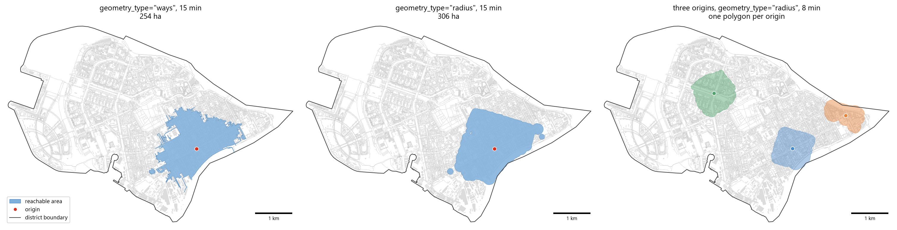
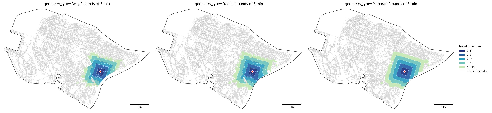

Isochrones
==========

Overview
--------

An **isochrone** is the area reachable from an origin within a travel-time or distance budget along a transport
network. ObjectNat builds isochrones on an ``iduedu.UrbanGraph`` prepared by `IduEdu
<https://github.com/IDUclub/IduEdu>`__ (walk, drive, public transport or intermodal graph).
:func:`objectnat.get_graph_isochrones` returns one polygon per origin; :func:`objectnat.get_stepped_graph_isochrones`
splits the reachable area into bands of width ``step``.

Method
------

1. Every origin is snapped to its nearest graph node, or node ids are taken from ``graph_node_column`` or
   ``origin_nodes``.
2. A Dijkstra search runs outward from the origins along the edge direction, with edge weights ``time_min``
   (minutes, default) or ``length_meter`` (metres), up to ``weight_value_cutoff``. The searches of all origins run in
   one parallel call of IduEdu's Numba routines.
3. The reachable nodes are turned into a polygon according to ``geometry_type``. The residual budget of a node
   (cutoff minus its cost) is converted to a distance, for ``time_min`` with the median edge speed of the graph
   (``length_meter / time_min``):

   - ``"radius"`` (default): union of buffers around the reachable nodes; the radius of a buffer is the residual
     distance of its node, but at most ``off_network_distance`` (150 m by default);
   - ``"ways"``: reachable edges buffered by ``road_buffer_size`` metres, limited by buffers of the full residual
     distance;
   - ``"separate"``: buffers of ``buffer_factor`` × residual distance around the reachable nodes, merged into one
     polygon.

4. The result is clipped to ``zone`` when it is given.

**Why the radius is capped.** A buffer by the whole residual distance assumes that a person can walk straight from
a node in any direction for the rest of the budget, across blocks, courtyards and water. At the origin this is the
whole budget, so a 10-minute walk isochrone becomes a disc of about 800 m whatever the street layout. The cap
follows the approach of trip planners such as OpenTripPlanner and Conveyal R5: the search runs along the network,
and only the last stretch from a street to a place, at most ``off_network_distance``, is walked off the network. The
isochrone then follows the streets that are actually reachable and narrows where they end. ``off_network_distance=None``
gives the uncapped buffers.

On walk and intermodal graphs only pedestrian edges (``type == "walk"``) shape ``"ways"``, and only their end nodes
shape any geometry: transit route nodes take part in the search, but their cost includes the boarding wait, and
several route nodes can share one stop location.

Stepped isochrones assign every reachable node to the interval ``[0, step), [step, 2·step), …`` that contains its
cost, up to ``weight_value_cutoff`` (by default the cost of the farthest reachable node), and build one band per
interval:
``geometry_type=None`` uses Voronoi cells around the nodes, ``"radius"`` and ``"ways"`` clip these cells to the
residual-radius buffers or to the buffered streets, and ``"separate"`` builds independent buffers per interval.
With several origins, the bands describe their combined reachability: each node keeps the cost from its nearest
origin. The column ``dist`` contains the upper bound of the interval.

Outputs
-------

GeoDataFrames in the CRS of the input origins. :func:`objectnat.get_graph_isochrones` has one row per origin with
``source_node`` and the input attributes; :func:`objectnat.get_stepped_graph_isochrones` has one row per band
and the column ``dist`` (minutes or metres).

.. autofunction:: objectnat.get_graph_isochrones

.. autofunction:: objectnat.get_stepped_graph_isochrones

Figures
-------

   15-minute isochrone on the intermodal graph of Vasilyevsky Island with ``geometry_type="ways"`` and
   ``"radius"``, and 8-minute ``"radius"`` isochrones of three origins (one polygon per origin). Background: pedestrian streets of the graph and the district boundary.

   Stepped isochrones up to 15 minutes in bands of 3 minutes, ``geometry_type="ways"``, ``"radius"`` and
   ``"separate"``; ``dist`` is the upper bound of the band. Background: pedestrian streets of the graph and the district boundary.

Limitations
-----------

- Travel times are those stored in the graph (``time_min``); congestion, timetables beyond the waiting times
  modelled by IduEdu, and turn penalties are not considered.
- The polygon outside the network is an interpolation. ``"radius"`` assumes straight-line movement for at most
  ``off_network_distance`` from the streets; ``"separate"`` assumes it for the whole residual budget and therefore
  overestimates reach across blocks without paths.
- Origins are snapped to the nearest graph node; the access distance from the origin to that node is not added.

Example notebook
----------------

:doc:`examples/isochrones`
