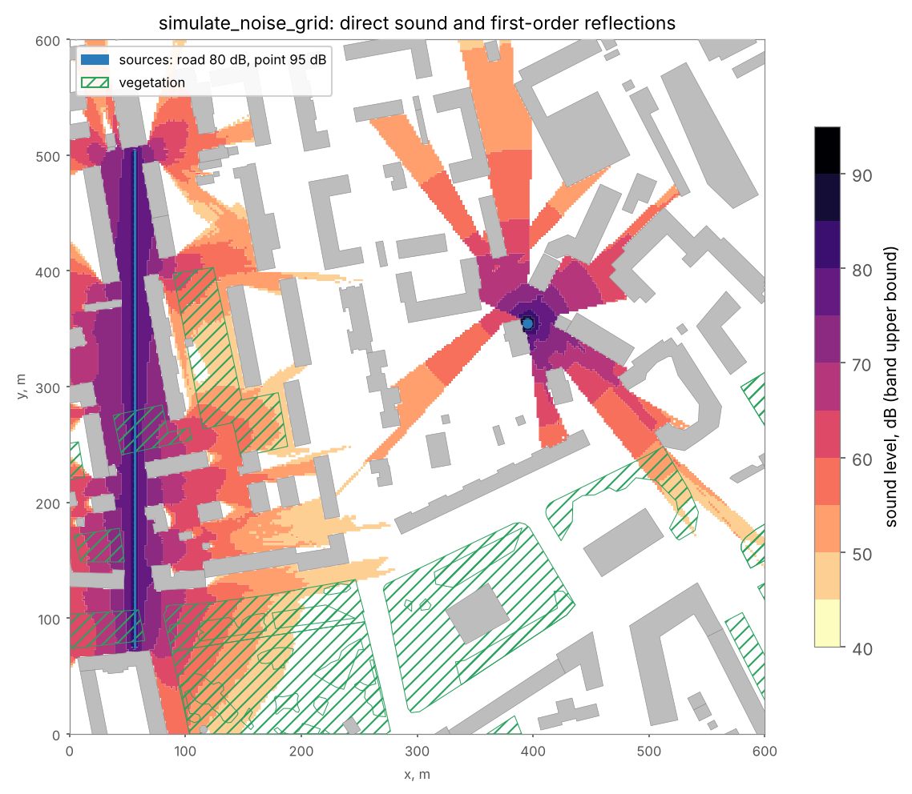
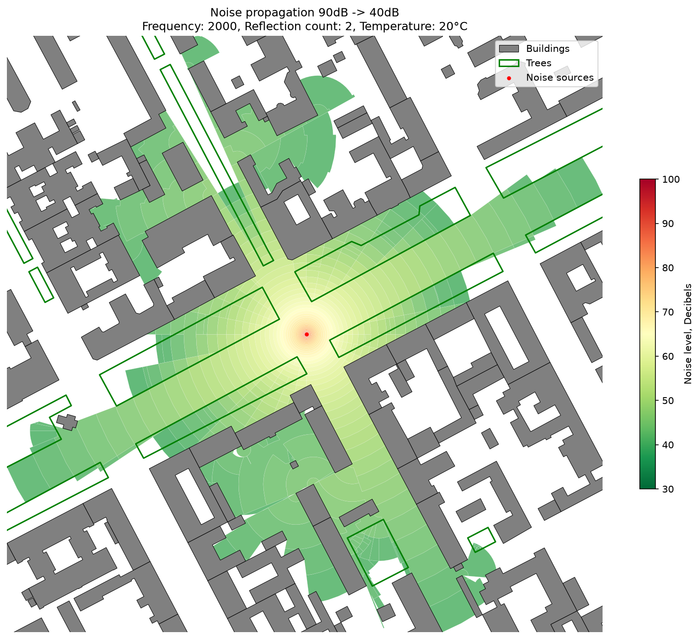
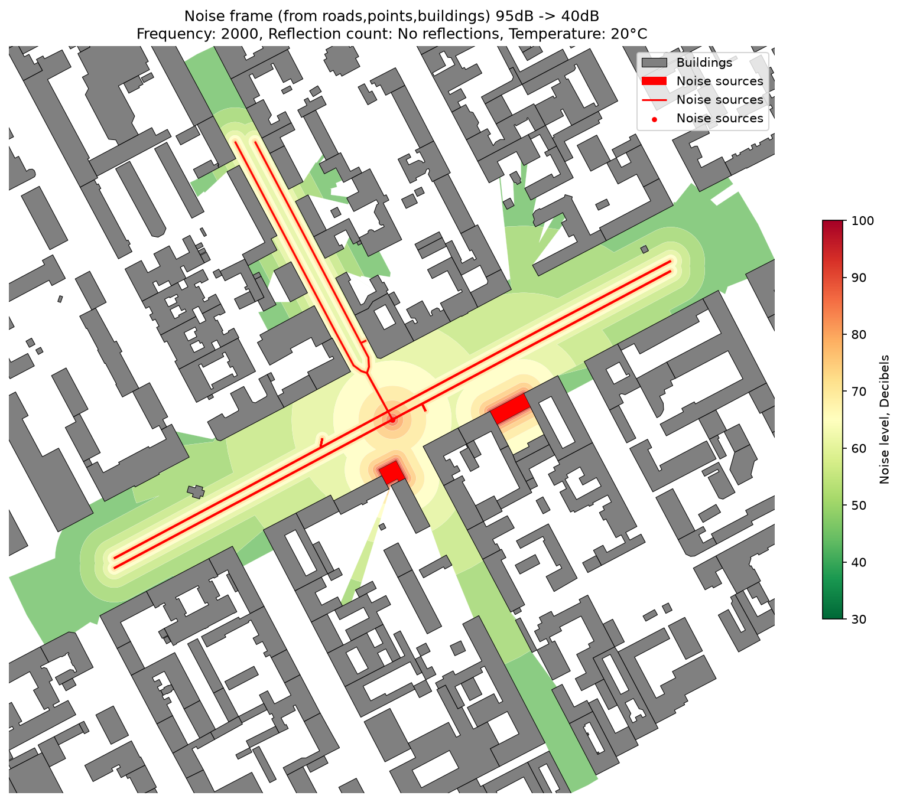

Noise Simulation
================

Overview
--------

The noise functions estimate sound levels around **sources** among **obstacles** (buildings, walls) and vegetation
and return them as polygons of equal level band (``noise_level``, dB). Three functions differ in the propagation
model and in cost:

.. list-table::
   :header-rows: 1
   :widths: 28 22 50

   * - Function
     - Sources
     - Model
   * - :func:`objectnat.simulate_noise_grid`
     - points, lines, polygons
     - Levels on a regular grid of **receivers**: direct path and first-order reflections, energy summation (Rust)
   * - :func:`objectnat.simulate_noise`
     - points
     - Wave-front propagation by decay layers with multiple reflections and obstacle absorption
   * - :func:`objectnat.calculate_simplified_noise_frame`
     - points, lines, polygons
     - Visibility masks and distance decay, without reflections or absorption

All three take the source level ``source_noise_db`` (dB at 1 m from the source) and the characteristic frequency
``geometric_mean_freq_hz`` (Hz) either as arguments or as per-source columns, and the air temperature (°C), which
sets the air absorption.

Receiver-grid simulation
------------------------

Method
~~~~~~

:func:`objectnat.simulate_noise_grid` computes the level at every receiver of a regular grid (``grid_step``
metres). Receivers inside obstacles are skipped. For each source and receiver it sums, as energies,

- the **direct path**, when no obstacle blocks the line between source and receiver;
- **first-order reflections** from obstacle walls within ``reflection_max_dist`` metres of the source (default 50
  m), found with the image-source method; each reflection loses ``-10 lg(1 - a)`` dB, where ``a`` is the
  absorption ratio of the wall (``absorb_ratio_column`` or ``standard_absorb_ratio``, default 0.05).

Every path of length ``r`` (m) loses ``20 lg r`` for geometric spreading and ``k r`` for air absorption, with ``k``
derived from the temperature and the frequency; a path through vegetation (``trees``) also loses a
frequency-dependent rate per metre of foliage crossed. Line sources (roads, railways) and polygon outlines
(industrial sites, noisy buildings) are sampled every ``source_spacing`` metres (default 5 m); each sample gets
``source_noise_db - 10 lg(π / s)`` so that a long line follows the line-source law
``L - 10 lg d - k d`` (3 dB less per doubling of distance). Because energies add, two equal sources give +3 dB.

Levels below ``target_noise_db`` are dropped, and the rest are grouped into bands of ``db_sim_step`` dB.
``noise_level`` is the upper bound of the band, as in :func:`objectnat.simulate_noise`. With
``return_receivers=True`` the receiver points with their exact levels are returned as well.

Computation time is proportional to the number of receivers times the number of point sources and line samples
within reach. For large road networks use a coarser ``grid_step`` or ``source_spacing``, or
:func:`objectnat.calculate_simplified_noise_frame` for a first estimate.

.. autofunction:: objectnat.simulate_noise_grid

   :func:`objectnat.simulate_noise_grid` for a road (line source, 80 dB at 1 m, 1 kHz) and a point source (95 dB,
   2 kHz) among the example buildings and vegetation, ``grid_step=2``, ``db_sim_step=5``,
   ``target_noise_db=40``. Behind buildings only reflected sound arrives.

Wave-front simulation
---------------------

Method
~~~~~~

:func:`objectnat.simulate_noise` models propagation from point sources in decay layers of ``db_sim_step`` dB. A
layer is the area within the distance at which the level drops by one step, limited by the visibility polygon of
the source. Obstacle boundaries reached by the sound become secondary sources of reflected sound, up to
``reflection_n`` reflections (default 3), with a level reduced by the absorption ratio of the obstacle
(``absorb_ratio_column``, ``standart_absorb_ratio``); no reflections start within ``dead_area_r`` metres of the
previous source. Vegetation
(``trees``, rasterized with ``tree_resolution``) reduces the level in the shadow sector behind tree polygons by a
frequency-dependent amount that grows with the depth of foliage crossed. The simulation stops at
``target_noise_db``. Sources inside an obstacle or tree polygon can be freed with ``source_position_buffer_r``;
``use_parallel`` distributes the work over processes.

.. autofunction:: objectnat.simulate_noise

   :func:`objectnat.simulate_noise` for one point source.

Simplified noise frame
----------------------

Method
~~~~~~

:func:`objectnat.calculate_simplified_noise_frame` builds an envelope of possible exposure without a propagation
simulation. Lines and polygons are sampled into points (``linestring_point_radius``, ``polygon_point_radius``),
the visibility polygon of every sample masks the area that the sound reaches directly, and the level decreases with
distance according to the source level, frequency and temperature. The frame of every source is the maximum over its
samples, and the result is the maximum over sources. Obstacles act only as line-of-sight masks: absorption,
reflections and vegetation are not modelled.

.. autofunction:: objectnat.calculate_simplified_noise_frame

   Simplified noise frame for point, line and polygon sources.

Limitations
-----------

- None of the models includes ground effect, diffraction over or around buildings, or meteorological refraction;
  :func:`objectnat.simulate_noise_grid` includes reflections of the first order only. Behind an obstacle the
  receiver-grid model therefore gives only reflected sound and can underestimate the level.
- Each source is described by one level and one characteristic frequency; spectra are not modelled, and the results
  are not equivalent to standardized calculation methods such as ISO 9613-2 or CNOSSOS-EU.
- :func:`objectnat.simulate_noise` and :func:`objectnat.calculate_simplified_noise_frame` combine sources by the
  band maximum; :func:`objectnat.simulate_noise_grid` sums energies.

Background on the wave-front model is given on the
`project wiki <https://github.com/IDUclub/ObjectNat/wiki/Noise-simulation>`__; the API reference on this page
describes the current behaviour.

Example notebook
----------------

:doc:`examples/noise`
