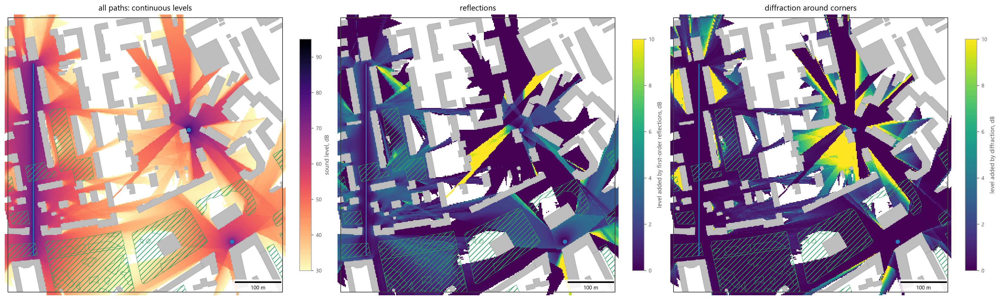
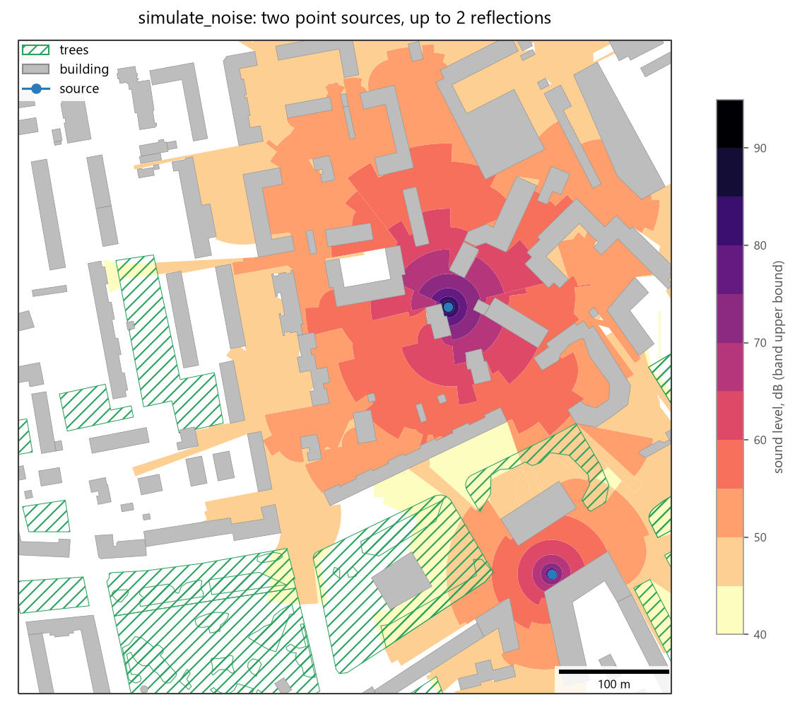
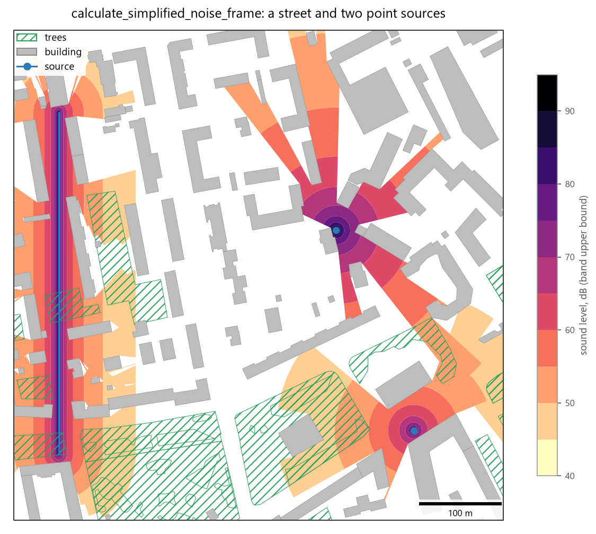

Noise Simulation
================

Overview
--------

The noise functions estimate sound levels around **sources** among **obstacles** (buildings, walls) and vegetation
and return them as polygons of level bands (``noise_level``, dB). The three functions differ in the propagation
model and in computation time:

.. list-table::
   :header-rows: 1
   :widths: 28 22 50

   * - Function
     - Sources
     - Model
   * - :func:`objectnat.simulate_noise_grid`
     - points, lines, polygons
     - Levels on a regular grid of **receivers**: direct path, first-order reflections and diffraction around
       building corners, energy summation (Rust)
   * - :func:`objectnat.simulate_noise`
     - points
     - Wave-front propagation by decay layers with multiple reflections and obstacle absorption
   * - :func:`objectnat.calculate_simplified_noise_frame`
     - points, lines, polygons
     - Visibility masks and distance decay, without reflections or absorption

All three take the source level ``source_noise_db`` (dB at 1 m from the source) and the characteristic frequency
``geometric_mean_freq_hz`` (Hz) either as arguments or as per-source columns, and the air temperature (°C), which
sets the air absorption.

Receiver-grid simulation
------------------------

Method
~~~~~~

:func:`objectnat.simulate_noise_grid` computes the level at every receiver of a regular grid (``grid_step``
metres). Receivers inside obstacles are skipped. For each source and receiver it sums, as energies,

- the **direct path**, when no obstacle blocks the line between source and receiver;
- **first-order reflections** from obstacle walls within ``reflection_max_dist`` metres of the source (default 50
  m), found with the image-source method; each reflection loses ``-10 lg(1 - a)`` dB, where ``a`` is the
  absorption ratio of the wall (``absorb_ratio_column`` or ``standard_absorb_ratio``, default 0.05);
- **diffraction around vertical edges** (``diffraction=True``): a corner that the source sees at the edge of an
  obstacle acts as a secondary source for the receivers that are hidden from the source but seen from the corner.
  Sound also travels along the shadowed side of the obstacle's convex hull to the next corner and bends around it;
  this path reaches the receivers right behind a building.

A diffracted path has the geometric spreading and air absorption of the direct distance ``d`` and, in addition, the
barrier attenuation of ISO 9613-2 without the ground term, ``10 lg(3 + 40 C3 δ / λ)``. Here ``δ`` is the path
difference, how much longer the path through the corners is than ``d``, and ``λ = c / f`` is the wavelength at the
characteristic frequency (``c = 331.3 + 0.606 T`` m/s, ``T`` in °C). Around one corner ``C3 = 1``, which is Maekawa's formula ``10 lg(3 + 20 N)`` with the Fresnel number
``N = 2 δ / λ``; around two corners ``e`` metres apart ``C3 = (1 + (5 λ / e)²) / (1/3 + (5 λ / e)²)``. The
attenuation is 4.8 dB at the shadow boundary and at most 20 dB around one corner and 25 dB around two. Corners
are the convex vertices of the merged obstacle outlines simplified by 0.5 m (buildings that touch form one
outline) and the ends of wall lines.

Every path of length ``r`` (m) loses ``20 lg r`` dB to geometric spreading and ``k r`` dB to air absorption, with
``k`` derived from the temperature and the frequency; a path through vegetation (``trees``) also loses a
frequency-dependent rate per metre of foliage crossed. Line sources (roads, railways) and polygon outlines
(industrial sites, noisy buildings) are sampled every ``source_spacing`` metres (default 5 m); each sample gets
``source_noise_db - 10 lg(π / s)`` so that a long line follows the line-source law
``L - 10 lg d - k d`` (3 dB less per doubling of distance). Because energies add, two equal sources give +3 dB.

Levels below ``target_noise_db`` are dropped, and the rest are grouped into bands of ``db_sim_step`` dB.
``noise_level`` is the upper bound of the band, as in :func:`objectnat.simulate_noise`. With
``output="receivers"`` the function returns the receiver points with their exact levels instead of the bands; with
``output="both"`` it returns both.

Computation time is proportional to the number of receivers times the number of point sources and line samples
within reach. For large road networks use a coarser ``grid_step`` or ``source_spacing``, or
:func:`objectnat.calculate_simplified_noise_frame` for a first estimate.

.. autofunction:: objectnat.simulate_noise_grid

Each band covers ``db_sim_step`` dB; the receivers (``output="receivers"``) have the exact level, and
:func:`objectnat.rasterize` turns them into a continuous map (see :doc:`rasters`).

**Reading the result.** The model is energetic: it returns the time-averaged sound level, the quantity that noise
maps and norms use, rather than the instantaneous sound pressure. Phase, wave fronts and interference are therefore
not computed, and the level falls smoothly with distance. The direct sound and the reflections travel along
straight rays, so they pass through the gaps between buildings as straight beams; a first-order reflection is the
field of a mirror image of the source behind the wall, limited to the rays that pass through the wall. Where the
direct sound already arrives, a reflection with a 5 % absorption ratio adds at most 3 dB. Diffraction fills the
shadows. At the shadow boundary the level drops by 4.8 dB, and it falls further as the detour grows; the 20 dB
limit is reached at a detour of 2.4 wavelengths, 0.4 m at 2 kHz and 1.7 m at 500 Hz. Shadows are therefore deeper
at high frequencies than at low ones. Right behind a building the sound bends around two corners and arrives up to
25 dB below the free-field level; places that sound reaches only around three or more corners (inner courtyards,
the second row behind a building) receive reflected sound only.

   :func:`objectnat.simulate_noise_grid` for a road (line source, 80 dB at 1 m, 1 kHz) and two point sources (95 dB
   at 2 kHz, 85 dB at 500 Hz) among the example buildings and vegetation, ``grid_step=2``, receivers rasterized
   with :func:`objectnat.rasterize`. ``target_noise_db=30`` shows the sound that reaches the shadows. Left:
   continuous levels with all paths. Centre and right: the level added by reflections (``reflections=False`` for
   comparison) and by diffraction (``diffraction=False``); cells reached only by these paths are compared with
   ``target_noise_db``. Diffraction fills the shadows beside the beams and behind the buildings next to the point
   sources.

Wave-front simulation
---------------------

Method
~~~~~~

:func:`objectnat.simulate_noise` models propagation from point sources in decay layers of ``db_sim_step`` dB. A
layer is the area within the distance at which the level drops by one step, limited by the visibility polygon of
the source. Obstacle boundaries reached by the sound become secondary sources of reflected sound, up to
``reflection_n`` reflections (default 3), with a level reduced by the absorption ratio of the obstacle
(``absorb_ratio_column``, ``standart_absorb_ratio``); no reflections start within ``dead_area_r`` metres of the
previous source. Vegetation (``trees``, rasterized with ``tree_resolution``) reduces the level in the shadow sector
behind tree polygons by a frequency-dependent amount that grows with the depth of foliage crossed. The simulation
stops at ``target_noise_db``. For a source inside an obstacle or tree polygon, ``source_position_buffer_r`` cuts a
hole of that radius around the source; ``use_parallel`` distributes the work over processes.

.. autofunction:: objectnat.simulate_noise

   :func:`objectnat.simulate_noise` for the two point sources of the :func:`objectnat.simulate_noise_grid` example
   (95 dB at 2 kHz, 85 dB at 500 Hz) among the example buildings and vegetation, ``reflection_n=2``,
   ``target_noise_db=40``, ``db_sim_step=5``.

Simplified noise frame
----------------------

Method
~~~~~~

:func:`objectnat.calculate_simplified_noise_frame` builds an envelope of possible exposure without a propagation
simulation. Lines and polygons are sampled into points (``linestring_point_radius``, ``polygon_point_radius``),
the visibility polygon of every sample masks the area that the sound reaches directly, and the level decreases with
distance according to the source level, frequency and temperature. The frame of every source is the maximum over its
samples, and the result is the maximum over sources. Obstacles act only as line-of-sight masks: absorption,
reflections and vegetation are not modelled.

.. autofunction:: objectnat.calculate_simplified_noise_frame

   :func:`objectnat.calculate_simplified_noise_frame` for the street (line source, 80 dB at 1 m) and the two point
   sources of the same example, ``target_noise_db=40``, ``db_sim_step=5``. Without reflections and diffraction only
   the places in the line of sight of a source are reached.

Limitations
-----------

- None of the models includes ground effect or meteorological refraction. :func:`objectnat.simulate_noise_grid`
  includes reflections of the first order and diffraction around one or two vertical edges in plan. It does not
  use building heights, so diffraction over roofs is not modelled, and places that sound reaches only around three
  or more corners receive reflections only, which can underestimate their level.
  :func:`objectnat.simulate_noise` and :func:`objectnat.calculate_simplified_noise_frame` include no diffraction.
- Each source is described by one level and one characteristic frequency; spectra are not modelled, and the results
  are not equivalent to standardized calculation methods such as ISO 9613-2 or CNOSSOS-EU.
- :func:`objectnat.simulate_noise` and :func:`objectnat.calculate_simplified_noise_frame` combine sources by the
  band maximum; :func:`objectnat.simulate_noise_grid` sums energies.

Background on the wave-front model is given on the
`project wiki <https://github.com/IDUclub/ObjectNat/wiki/Noise-simulation>`__; the API reference on this page
describes the current behaviour.

Example notebook
----------------

:doc:`examples/noise`
