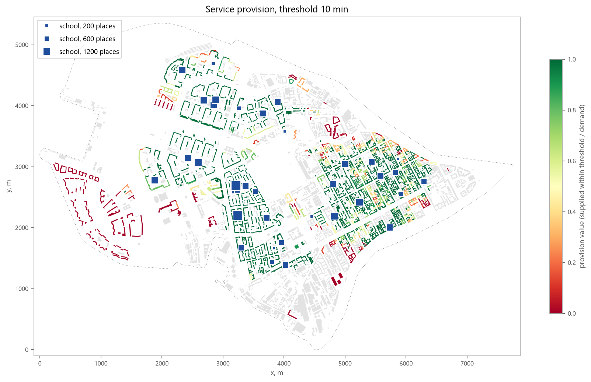
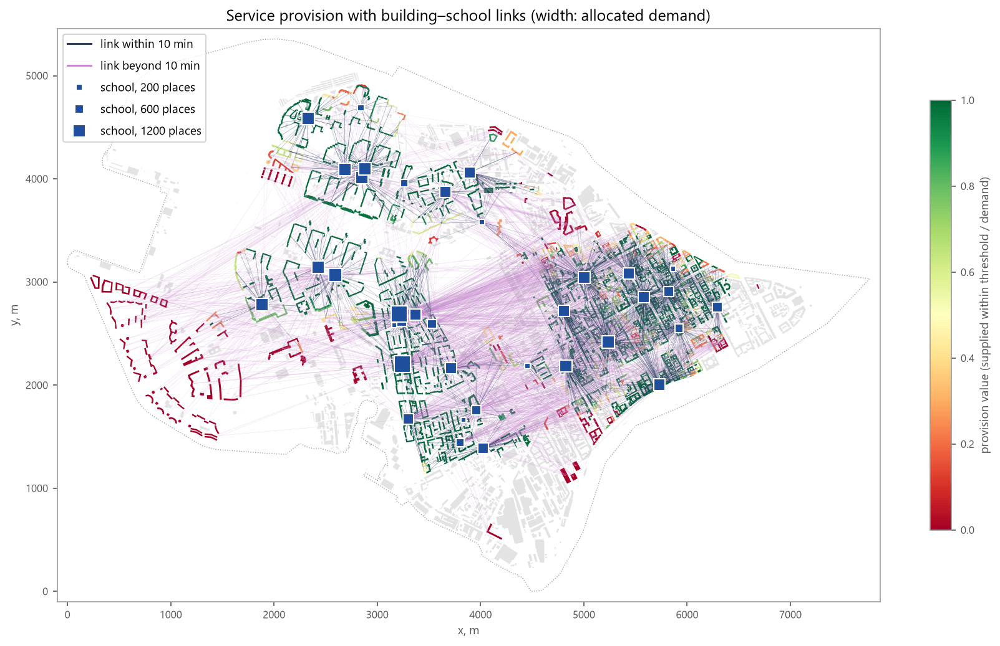
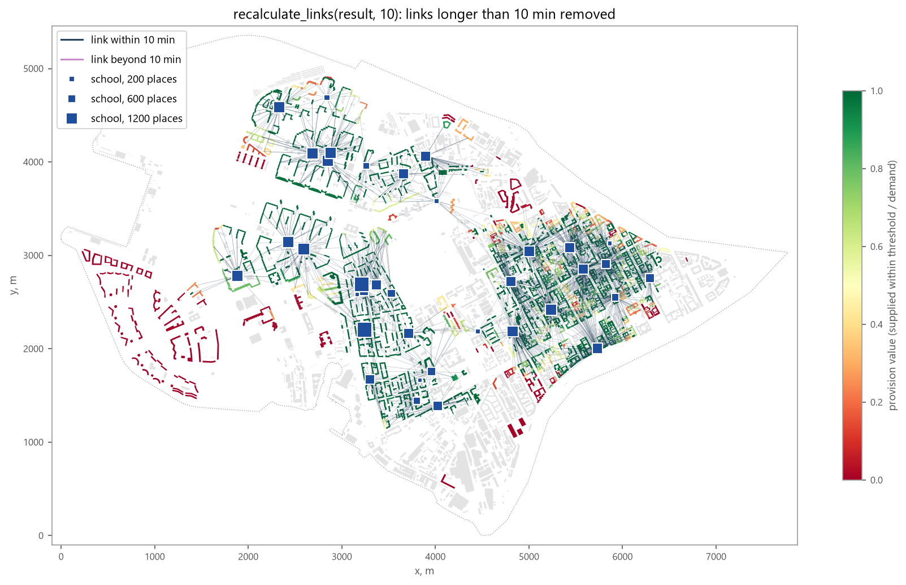
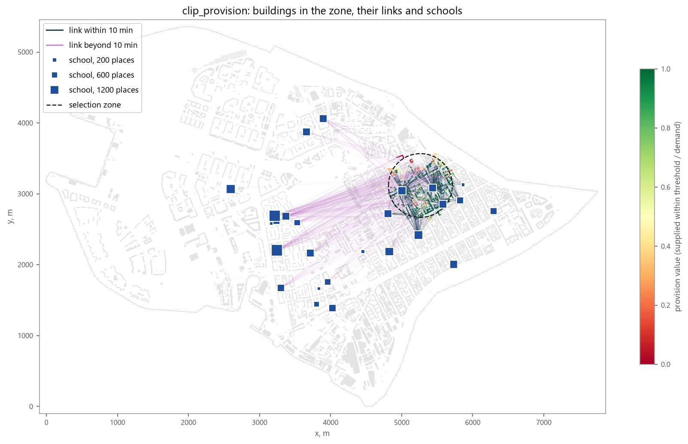

Service Provision
=================

Overview
--------

Service provision analysis allocates the **demand** of buildings (for example, the number of school-age children)
to **services** with limited **capacity** (school places), given a matrix of travel costs between them and a
normative **threshold** (minutes or metres). It shows which buildings are provided within the threshold, which are
provided only by services farther away, and which services are overloaded or underused.

:func:`objectnat.get_service_provision` computes the allocation and returns a :class:`objectnat.ProvisionResult`.
Helper functions join the metrics back to the buildings and services and build link geometries;
:func:`objectnat.recalculate_links` and :func:`objectnat.clip_provision` adjust a computed result.

Inputs
------

- ``buildings``: GeoDataFrame with a numeric demand column (``buildings_demand_column``, default ``"demand"``);
- ``services``: GeoDataFrame with a numeric capacity column (``services_capacity_column``, default ``"capacity"``);
- ``distance_matrix``: costs with rows ``buildings.index`` and columns ``services.index``, in the units of
  ``threshold``. It may be a dense DataFrame (``inf`` or ``NaN`` for unreachable pairs) or a pandas sparse
  DataFrame (``SparseDtype`` with ``NaN`` or ``inf`` as fill value) that stores only reachable pairs. Sparse
  matrices are read entry by entry without densifying, so large areas fit in memory. IduEdu's ``od_matrix``
  returns such a sparse matrix (see :doc:`examples/calculate_od_matrix`).

Method
------

The allocation is a gravity-based probabilistic model computed in ObjectNat's Rust extension over the sparse
matrix entries:

1. Candidate links are building–service pairs with a finite cost ``d <= 3 * threshold``; the model uses
   ``a = d + 1``.
2. In each iteration every service with remaining capacity distributes it over the buildings with remaining
   demand within the current selection range, keeping the buildings whose gravity weight ``1 / a²`` is in the upper
   quantile of its candidates, by weighted random draws.
3. Every building accepts at most its remaining demand from the offers, again by weighted draws.
4. Buildings and services with no remaining demand, capacity or candidates drop out; the selection range grows by
   a factor of 1.5, and the iterations continue until nothing can be allocated.

The random streams are seeded per object and iteration from ``seed``, so a fixed seed gives the same result
regardless of the number of CPU cores. Different seeds give alternative allocations with the same model.

Outputs
-------

:class:`objectnat.ProvisionResult` holds

- ``flow``: sparse building × service matrix of allocated demand;
- ``demand_rows``: per building ``demand``, ``demand_left``, ``supplied_demands_within`` and
  ``supplied_demands_without`` (allocated from services within / beyond ``threshold``), ``min_dist`` (cost to the
  nearest service), ``avg_dist`` (flow-weighted mean cost) and ``provision_value`` =
  ``supplied_demands_within / demand``;
- ``capacity_rows``: per service ``capacity``, ``capacity_left``, ``carried_capacity_within``,
  ``carried_capacity_without`` and ``service_load`` (total allocated demand);
- ``distance_matrix`` and ``threshold`` used for the calculation.

:func:`objectnat.get_provision_buildings` and :func:`objectnat.get_provision_services` join these metrics to copies
of the input GeoDataFrames; :func:`objectnat.get_provision_links` returns one straight line per non-zero flow, from the
representative point of the building to the service, with ``building_index``, ``service_index``, ``demand``
(allocated units) and ``distance`` (cost).

.. autofunction:: objectnat.get_service_provision

.. autoclass:: objectnat.ProvisionResult
   :members:

.. autofunction:: objectnat.get_provision_buildings

.. autofunction:: objectnat.get_provision_services

.. autofunction:: objectnat.get_provision_links

   Provision value of residential buildings for the example schools with a 10-minute threshold on the intermodal
   travel-time matrix (``seed=0``); square size shows school capacity. Non-residential buildings are grey.

   The same result with :func:`objectnat.get_provision_links`: one line per non-zero flow, width proportional to
   the allocated demand. Dark links lie within the threshold, light ones beyond it (up to ``3 * threshold``); the
   latter carry the demand that the schools within 10 minutes cannot take.

Recalculation and clipping
--------------------------

:func:`objectnat.recalculate_links` removes the flows whose cost exceeds ``new_max_dist`` and rebuilds the
aggregate metrics without a new allocation. The removed demand is not redistributed to other services; run
:func:`objectnat.get_service_provision` again for a full reallocation.

:func:`objectnat.clip_provision` keeps the buildings that intersect ``selection_zone``, the links of these buildings
and the services the links refer to. All four inputs must share one CRS.

.. autofunction:: objectnat.recalculate_links

.. autofunction:: objectnat.clip_provision

   ``recalculate_links(result, 10)``: the links longer than 10 minutes are removed and the metrics are rebuilt;
   their demand stays unallocated.

   :func:`objectnat.clip_provision` with a 450 m circle: the buildings in the zone, all their links and the schools
   these links lead to, also outside the zone.

Limitations
-----------

- The allocation is stochastic: individual flows depend on ``seed``, aggregate metrics vary little between seeds
  for large inputs but can vary for small ones.
- Demand and capacity are integers (allocated in units); fractional values are truncated.
- The model has no explicit choice behaviour (quality, preference, catchment rules); every reachable service
  within ``3 * threshold`` can receive demand.
- The result is only as accurate as the cost matrix; the example matrix holds travel times on an intermodal graph
  in minutes.

Example notebooks
-----------------

:doc:`examples/calculate_od_matrix` (cost matrix with IduEdu) and :doc:`examples/provision`.
