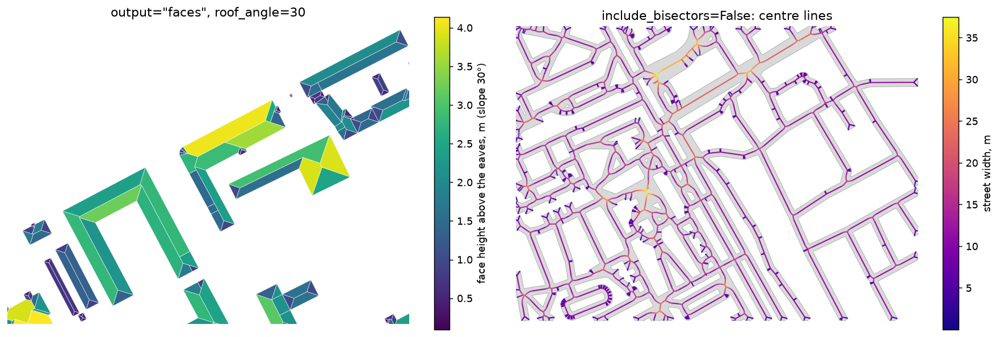

Straight Skeleton
=================

Overview
--------

The straight skeleton of a polygon is what its boundary traces when every edge moves inwards at the same speed.
Each edge sweeps one face, the faces meet along the arcs of the skeleton, and every point of the skeleton lies at a
known distance from the boundary. :func:`objectnat.get_straight_skeleton` returns either the arcs or the faces:

- the arcs between inner vertices follow the middle of the polygon: they are the **centre lines** of road, river
  or corridor polygons, and twice the distance to the boundary is the local width;
- the faces are the slopes of a **hipped roof** over a building outline; with ``roof_angle`` they are returned in
  3D.

   Left: roof faces of buildings in the example district, coloured by their height above the eaves at a slope of
   30°. Right: centre lines of a street polygon (pedestrian ways of the test district buffered by 6 m), coloured
   by the street width.

Method
------

Polygons and the parts of MultiPolygons are processed independently and in parallel by the compiled extension; a
geographic CRS is projected to its UTM zone for the calculation, so distances are in metres. The algorithm is an
event-driven wavefront: every edge moves inwards at unit speed, and the skeleton records where edges vanish or
the wavefront splits. It handles holes, simultaneous events (squares, regular and rectilinear shapes) and thin
strips with nearly parallel sides. The Rust code is vendored from the ``geo-straight-skeleton`` crate (MIT
licence), which is checked against CGAL's straight skeleton.

- ``output="arcs"``: one LineString per arc, with ``dist_start`` and ``dist_end``, the distance from the boundary
  at its ends. The arcs that start at polygon corners (bisectors) are included unless ``include_bisectors=False``,
  which keeps the centre lines only.
- ``output="faces"``: one Polygon per polygon edge, with ``ring`` (0 for the exterior, then the holes) and
  ``edge`` (the edge number within the ring). The faces cover the polygon exactly. With ``roof_angle`` the height
  of every vertex is its distance from the boundary times ``tan(roof_angle)``.

Every row keeps the index of its source row and has a ``part`` column, the part of a MultiPolygon.

Notes:

- A polygon with crossing or touching edges, a ring of zero area or a hole outside the exterior has no straight
  skeleton; it is skipped with a warning that counts the skipped polygons by reason.
- The centre line of a strip stops half its width before the end of the strip, where the corner arcs meet.
- Small bends of the boundary produce short side arcs; they can be dropped by length or by distance.

Straight skeleton
-----------------

.. autofunction:: objectnat.get_straight_skeleton
