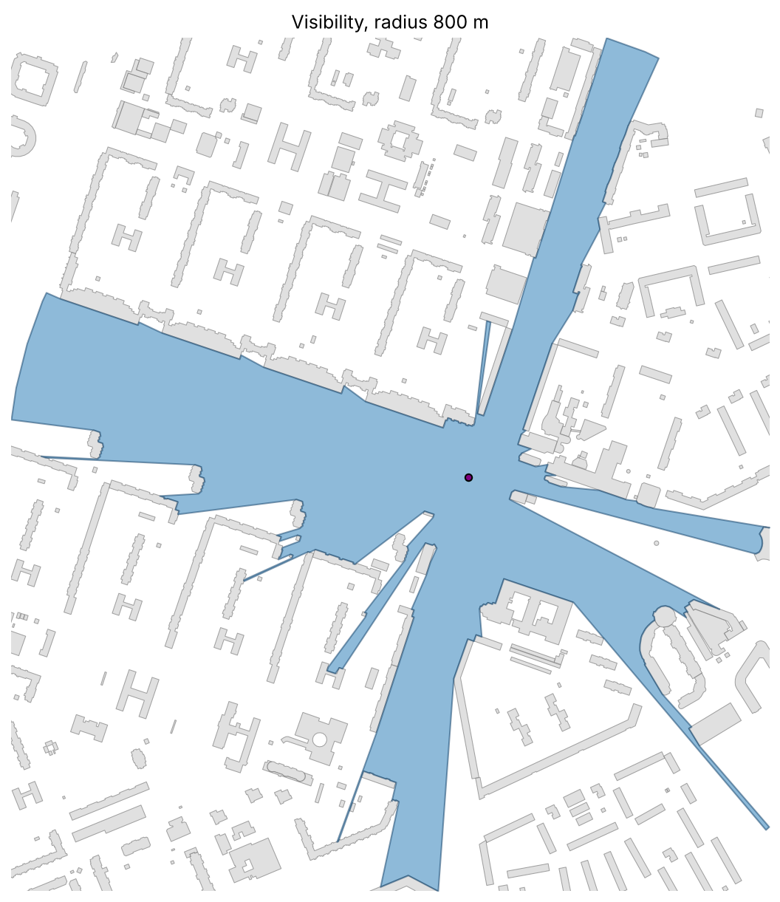

Visibility Analysis
===================

**Visibility analysis** estimates which **buildings**, **barriers**, or **areas**
are visible from one or multiple observer points within a given distance.
It is commonly used in studies of **visual accessibility**, **urban perception**,
**noise propagation**, and **urban form analysis**.

----

    The module computes exact visibility from a single point or from a large batch of
    points in parallel with :func:`objectnat.get_visibility`, 2.5D visibility over buildings of
    known height and terrain with :func:`objectnat.get_viewshed`, and aggregates the visibility
    of many observers into catchment zones with :func:`objectnat.get_visibility_catchment`.

----

Method
------

:func:`objectnat.get_visibility` returns, for each observer, the exact area visible within its
viewing radius: the view disc minus everything hidden behind obstacle walls. Obstacles may be
polygons (with holes) or lines. The calculation runs in ObjectNat's compiled Rust extension
(``objectnat._rust``), multi-threaded over observers, and handles thousands of observers per second.

``method="simple"`` (a ray-based approximation) is deprecated: the exact algorithm is now faster than
it was, so both values of ``method`` return the exact result.

.. autofunction:: objectnat.get_visibility

   Area visible from one point within 800 m among the example buildings.

----

Isovist Metrics
---------------

A visibility polygon is also called an **isovist**. ``get_visibility(..., isovist_metrics=True)`` describes
each one with numbers, so observers can be compared, mapped or fed into models (Benedikt 1979, Batty 2001,
Turner et al. 2001). All lengths are in metres.

.. list-table::
   :header-rows: 1
   :widths: 22 78

   * - Column
     - Meaning
   * - ``area``, ``perimeter``
     - Size of the visible area and length of its boundary.
   * - ``compactness``
     - 4πA/P²: 1 for the full view disc, small for narrow or jagged views.
   * - ``occlusivity``, ``n_occlusions``
     - Total length and number of occluding edges: shadow boundaries where the view continues behind an
       obstacle edge. High values mean a fragmented view with many hidden spaces nearby.
   * - ``min_radial``, ``max_radial``
     - Distance from the observer to the nearest and farthest visible boundary point.
   * - ``mean_radial``, ``std_radial``, ``skew_radial``
     - Mean, standard deviation and skewness of the distance to the boundary over all directions. They are
       integrated exactly over each boundary edge, not sampled along rays.
   * - ``drift``
     - Distance from the observer to the centroid of the visible area: how off-centre the view is.
   * - ``view_share``
     - Visible area divided by the area of the view disc.
   * - ``open_share``
     - Share of the boundary lying on the view-distance limit rather than on obstacles.

Observers inside an obstacle get ``NaN``. The metrics add little time to the visibility itself (about
0.8 s for 5,000 isovists with 450,000 vertices).

----

2.5D Visibility (Viewsheds)
---------------------------

:func:`objectnat.get_visibility` treats every obstacle as infinitely high. :func:`objectnat.get_viewshed`
uses building heights and terrain instead: an observer at eye height (``observer_height``, 1.6 m by default,
or on the roof when standing inside a footprint) sees over a garage onto the street behind it, from a hill
over the roofs, from a tower far across the district, while a hill hides the valley behind it.

The area within the viewing radius is split into ``cell_size`` cells, and a cell is visible when the
straight line from the eye to the cell centre at ``target_height`` (0 for the ground, 1.6 m to see people)
passes above every wall it crosses and above the terrain. The lines of sight are checked in the Rust
extension, shared with :func:`objectnat.get_insolation`; visible cells are merged into one polygon per
observer. ``include_roofs=True`` also returns the parts of flat roofs that can be seen. Building heights and
terrain are given as for insolation: a height or storeys column, and a terrain GeoDataFrame of polygons with
heights, a GeoTIFF or an array.

For observers on the ground among buildings taller than the eye the result matches
:func:`objectnat.get_visibility` up to the cell size; it differs where buildings are low, observers are
high or the terrain is not flat.

.. autofunction:: objectnat.get_viewshed

:func:`objectnat.get_viewshed_catchment` is the 2.5D counterpart of the visibility catchment below: every
cell gets the number of observers (or the sum of their weights) whose line of sight to it is clear. The
observers' eyes stand ``observer_height`` above the terrain, so on hills they see over the houses below, and
with ``include_roofs=True`` the zones also show which roofs and building tops are seen from the streets.
Building footprints are rasterized once in the Rust extension, and the lines of sight of all observers are
counted there too.

.. autofunction:: objectnat.get_viewshed_catchment

----

Visibility Catchment Areas
--------------------------

:func:`objectnat.get_visibility_catchment` shows **where things can be seen from most often**. Observers are
placed densely, typically every 10–20 m along the streets with :func:`objectnat.get_observer_points`. The
area around them is split into square cells, and each cell gets the number of observers that see its centre
(their exact visibility polygons are accumulated in the Rust extension, without building them in Python), or
the sum of their weights when ``weight_column`` is given (e.g. pedestrian flow). Cells seen by nobody,
including cells inside buildings, are left out. The rest are grouped into classes and every class is
returned as one zone:

- ``classes=5`` (the default) builds classes from quantiles of the cell values; it adapts to the data, so
  class numbers are relative to one run;
- ``classes=[1, 10, 50, 100]`` sets the class lower bounds explicitly, in observer counts (or weight
  sums), so zones of different areas or scenarios share one scale.

Each zone carries ``visibility_class`` (``1`` is the least visible) and the range of cell values in it
(``count_min`` / ``count_max``, or ``weight_min`` / ``weight_max``). Zone outlines follow the cell grid, so
``cell_size`` sets their detail; time and memory grow with the number of cells. Visibility is symmetric, so
a cell's value is also the number of observers visible *from* it.

.. autofunction:: objectnat.get_visibility_catchment

.. autofunction:: objectnat.get_observer_points

.. figure:: https://github.com/user-attachments/assets/b5b0d4b3-a02f-4ade-8772-475703cd6435
   :alt: visibility-catchment-area
   :align: center
   :width: 80%

   Visibility catchment zones: places seen from many locations in an urban environment.

----

Example notebook
----------------

:doc:`examples/visibility`