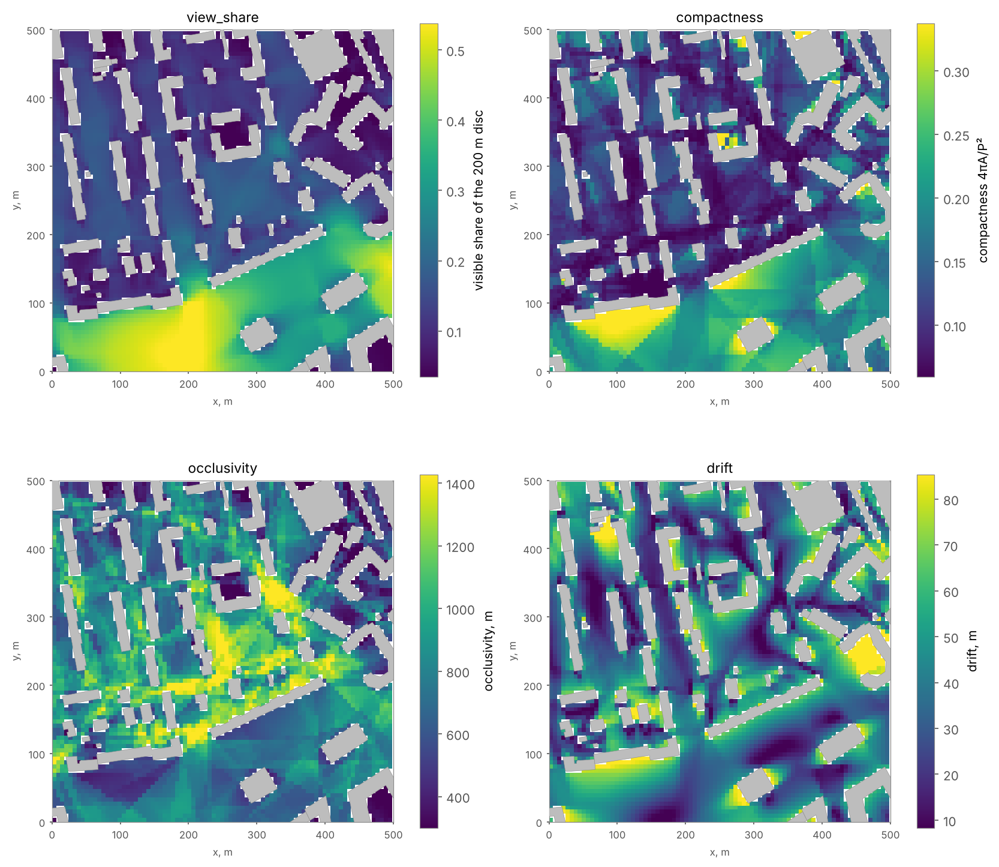
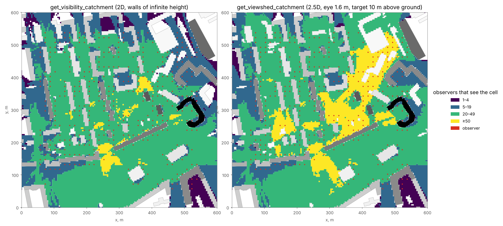

Visibility Analysis
===================

Overview
--------

Visibility analysis determines which parts of the urban space an **observer** can see and, aggregated over many
observers, how often each place is seen. ObjectNat provides two models:

- **2D visibility** (:func:`objectnat.get_visibility`, :func:`objectnat.get_visibility_catchment`): every obstacle
  is a wall of infinite height. The result for one observer is its exact **visibility polygon** (isovist).
- **2.5D visibility** (:func:`objectnat.get_viewshed`, :func:`objectnat.get_viewshed_catchment`): buildings have
  heights and the ground can have terrain. The result for one observer is its **viewshed**, the set of grid cells
  to which the line of sight from the eye is clear.

The catchment functions count, for every cell of a grid, the observers that see it and merge cells into
**catchment zones** of equal visibility class. :func:`objectnat.get_observer_points` places observers along the
streets of an IduEdu graph. All calculations run in ObjectNat's Rust extension, multi-threaded.

2D visibility polygons
----------------------

Method
~~~~~~

:func:`objectnat.get_visibility` returns, for each observer, the part of the view disc (radius ``view_distance``
or the per-observer column ``visibility_distance``, in metres) that is not hidden behind obstacle walls. Obstacles
may be polygons (with holes) or lines. Observers and obstacles are reprojected to an estimated UTM zone. Obstacle
walls are clipped to the disc, every wall endpoint and wall intersection defines a critical direction, and one ray
per angular interval finds the nearest wall; the boundary is therefore exact, not sampled. Observers standing
inside an obstacle get an empty polygon.

``method="simple"`` (a ray-sampling approximation in ObjectNat 1.x) is deprecated: both values of ``method``
return the exact result, and ``resolution`` and ``parallel`` have no effect.

Isovist metrics
~~~~~~~~~~~~~~~

With ``isovist_metrics=True`` each visibility polygon is described by the measures below (Benedikt 1979; Turner et
al. 2001; Batty 2001). Lengths are in metres, areas in square metres; observers inside an obstacle get ``NaN``.

.. list-table::
   :header-rows: 1
   :widths: 24 76

   * - Column
     - Definition
   * - ``area``, ``perimeter``
     - Area of the visibility polygon and length of its boundary.
   * - ``compactness``
     - 4πA/P²; 1 for the full view disc, small for narrow or jagged visibility polygons.
   * - ``occlusivity``, ``n_occlusions``
     - Total length and number of occluding edges, i.e. boundary edges along which the view continues behind an
       obstacle corner. High values indicate many partly hidden spaces near the observer.
   * - ``min_radial``, ``max_radial``
     - Distance from the observer to the nearest and the farthest boundary point.
   * - ``mean_radial``, ``std_radial``, ``skew_radial``
     - Mean, standard deviation and skewness of the distance to the boundary over all directions, integrated
       exactly over each boundary edge.
   * - ``drift``
     - Distance from the observer to the centroid of the visibility polygon.
   * - ``view_share``
     - Area of the visibility polygon divided by the area of the view disc.
   * - ``open_share``
     - Share of the boundary length that lies on the view-distance limit rather than on obstacles.

The metrics add little time to the visibility calculation (about 0.8 s for 5,000 visibility polygons with 450,000
vertices in total).

.. autofunction:: objectnat.get_visibility

.. figure:: https://raw.githubusercontent.com/IDUclub/ObjectNat/assets/visibility_example.png
   :alt: Visibility polygon of one observer
   :align: center
   :width: 70%

   Visibility polygon of one observer within 800 m among the example buildings.

   Isovist metrics of 5,328 observers placed every 6 m on open ground, ``view_distance=200``. Each cell shows the
   value of the observer at its centre; colour scales span the 2nd–98th percentiles.

2.5D viewsheds
--------------

Method
~~~~~~

:func:`objectnat.get_viewshed` uses building heights and terrain. The eye of an observer is ``observer_height``
(default 1.6 m) above the terrain or, for an observer inside a building footprint, above the roof. The area within
the viewing radius is divided into square cells of ``cell_size`` metres. A cell is visible when the straight line
from the eye to the cell centre at ``target_height`` above the ground (0 m for the ground surface, about 1.6 m for
people's faces) passes above every wall it crosses and above the terrain. Visible cells are merged into one
(Multi)Polygon per observer. With ``include_roofs=True`` cells on flat roofs are targets too, at the roof height.
Building heights and terrain are specified as for :func:`objectnat.get_insolation` (a height or storeys column; a
terrain GeoDataFrame, GeoTIFF or array), and the line-of-sight test shares its Rust implementation with
insolation.

The output keeps the index and attributes of the observers and adds ``visible_area`` (m²) and ``visible_share``,
the share of target cells within the radius that are visible. ``visibility_distance`` and ``observer_height``
columns override the arguments per observer. Computation time grows with ``(view_distance / cell_size) ** 2``
per observer.

For an observer on flat ground whose eye is lower than all surrounding buildings, the viewshed coincides with the
2D visibility polygon up to the cell size. The two differ where buildings are lower than the line of sight: from
a roof, from a hill, or when the target is above the ground (``target_height``).

.. autofunction:: objectnat.get_viewshed

.. figure:: https://raw.githubusercontent.com/IDUclub/ObjectNat/assets/viewshed_vs_visibility.png
   :alt: 2D visibility polygon, street-level viewshed and roof-level viewshed
   :align: center
   :width: 100%

   One observer on a street: 2D visibility polygon (left) and 2.5D viewshed at 1.6 m eye height (centre), both
   2.8 ha within 300 m. Right: an observer on the roof edge of a 17-storey building, ``include_roofs=True``; the
   viewshed covers 9.6 ha of ground and roofs. Grey shades give building height; ``cell_size=2``.

Visibility catchment zones
--------------------------

Method
~~~~~~

:func:`objectnat.get_visibility_catchment` estimates how often each place is seen. Observers are typically placed
every 10–20 m along streets with :func:`objectnat.get_observer_points`, which splits every street edge of the graph
(pedestrian edges on walk and intermodal graphs) into pieces of about ``spacing`` metres and puts one point in the
middle of each piece. The area around the observers is divided into square cells of ``cell_size`` metres; each
cell gets the number of observers whose visibility polygon contains its centre, or the sum of their weights when
``weight_column`` is given (for example, pedestrian flow). Visibility polygons are accumulated in the Rust extension
without building them in Python. Cells seen by no observer, including cells inside obstacles, are left out.

The remaining cells are grouped into classes, and every class becomes one zone:

- ``classes=5`` (default) builds class bounds from quantiles of the non-zero cell values. The bounds depend on the
  data, so class numbers are comparable only within one run;
- ``classes=[1, 10, 50, 100]`` sets the lower class bounds explicitly, in observer counts (or weight sums), so that
  areas or scenarios share one scale.

Each zone has ``visibility_class`` (``1`` is the least visible class) and the range of cell values in it,
``count_min`` / ``count_max`` (``weight_min`` / ``weight_max`` with weights). Zone outlines follow the cell grid;
time and memory grow with the number of cells. Visibility is symmetric, so the value of a cell is also the number
of observers visible from that cell.

:func:`objectnat.get_viewshed_catchment` is the 2.5D counterpart: a cell counts an observer when the line of sight
from the observer's eye to the cell target is clear, as in :func:`objectnat.get_viewshed`. Observers inside
building footprints are left out. Building footprints are rasterized once, and the lines of sight of all observers
are counted in the Rust extension. With ``include_roofs=True`` roof cells are classified too; roofs are seen from
street level only where the terrain or ``observer_height`` lifts the eye above them.

.. autofunction:: objectnat.get_visibility_catchment

.. autofunction:: objectnat.get_viewshed_catchment

.. autofunction:: objectnat.get_observer_points

   Catchment zones of 376 observers on open ground within 12 m of buildings, ``view_distance=250``,
   ``cell_size=4``, ``classes=[1, 5, 20, 50]``. Left: 2D. Right: 2.5D with ``target_height=10``, i.e. where a point
   10 m above the ground is seen from; it is seen over buildings lower than the line of sight, so more cells reach
   the upper classes.

Limitations
-----------

- 2D visibility ignores heights: low walls, fences and garages block the view as tall buildings do.
- 2.5D viewsheds use flat roofs and vertical walls; trees, street furniture and pitched roofs are not modelled.
  Results are discrete at ``cell_size``.
- Neither model accounts for atmospheric conditions, lighting or the visual acuity of the observer; a cell is
  visible if the geometric line of sight is clear within the viewing radius.
- Catchment class bounds built from quantiles (``classes`` as an integer) are relative to one run.

Example notebooks
-----------------

:doc:`examples/visibility` (2D visibility, isovist metrics, catchment zones) and :doc:`examples/viewshed` (2.5D
viewsheds and viewshed catchment).
