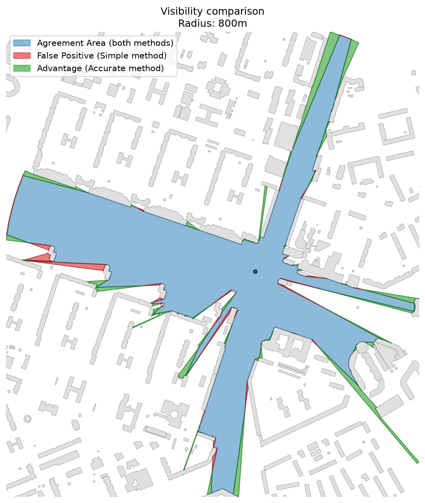

Visibility Analysis
===================

**Visibility analysis** estimates which **buildings**, **barriers**, or **areas**
are visible from one or multiple observer points within a given distance.
It is commonly used in studies of **visual accessibility**, **urban perception**,
**noise propagation**, and **urban form analysis**.

----

    The module provides a unified interface for visibility computation through
    the :func:`objectnat.get_visibility` function, supporting both high-accuracy
    and fast approximate algorithms. The user can compute visibility from
    a single point or from a large batch of points in parallel.

----

Visibility Methods
------------------

Two algorithmic modes are available through the ``method`` parameter:

**Accurate method (``method="accurate"``)**
    Performs detailed visibility computation based on obstacle boundaries,
    angular relations, and iterative polygon subtraction.
    This method captures narrow occlusions, corners, and complex geometry
    with high precision, making it ideal for **urban micro-scale** analysis.

**Simple method (``method="simple"``)**
    Computes visibility using radial rays projected from the observer.
    It is significantly faster and suitable for **large datasets**,
    **noise modelling**, and **regional-scale visibility studies**.

Both methods are accessed via a single API:

.. autofunction:: objectnat.get_visibility

   Comparison between accurate (boundary-based) and simple (ray-based) methods.

----

Optional Rust core
------------------

When the optional ``objectnat-core`` package is installed, ``method="accurate"`` (and the visibility
step of the noise simulation) runs on a native, multi-threaded implementation. It computes the same
exact visible area: on the example buildings its polygons match the Python implementation and an
independent brute-force reference with IoU 1.0, while running 13–154× faster per observer
end to end and handling thousands of observers per second.
See ``benchmarks/results/visibility.md`` in the repository for the full comparison.

.. code-block:: bash

    pip install ./objectnat-core    # from a repository checkout; needs a Rust toolchain

The core is used automatically. To force the pure-Python implementation:

.. code-block:: python

    from objectnat import config
    config.set_enable_rust_core(False)

----

Catchment Visibility from Multiple Points
-----------------------------------------

Performs visibility analysis for a **dense grid of observer points**,
producing combined **catchment visibility zones** — areas showing where specific
objects (e.g., landmarks, buildings) can be seen from.

.. figure:: https://github.com/user-attachments/assets/b5b0d4b3-a02f-4ade-8772-475703cd6435
   :alt: visibility-catchment-area
   :align: center
   :width: 80%

   Example of visibility polygons aggregated into **visibility pools** —
   zones most visible from multiple locations in an urban environment.

----

Example notebook
----------------

:doc:`examples/visibility`