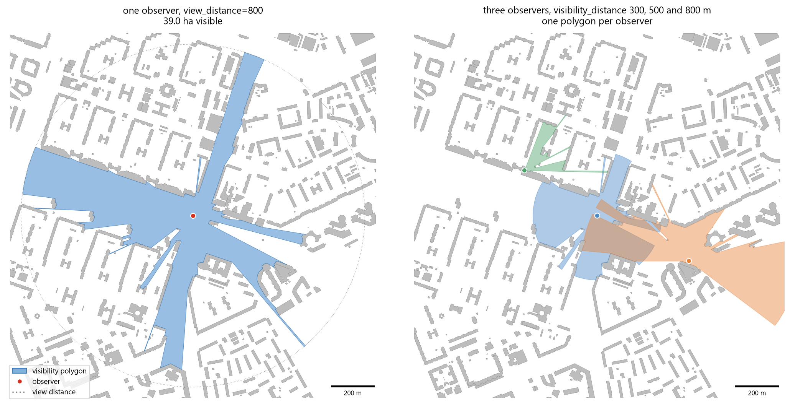
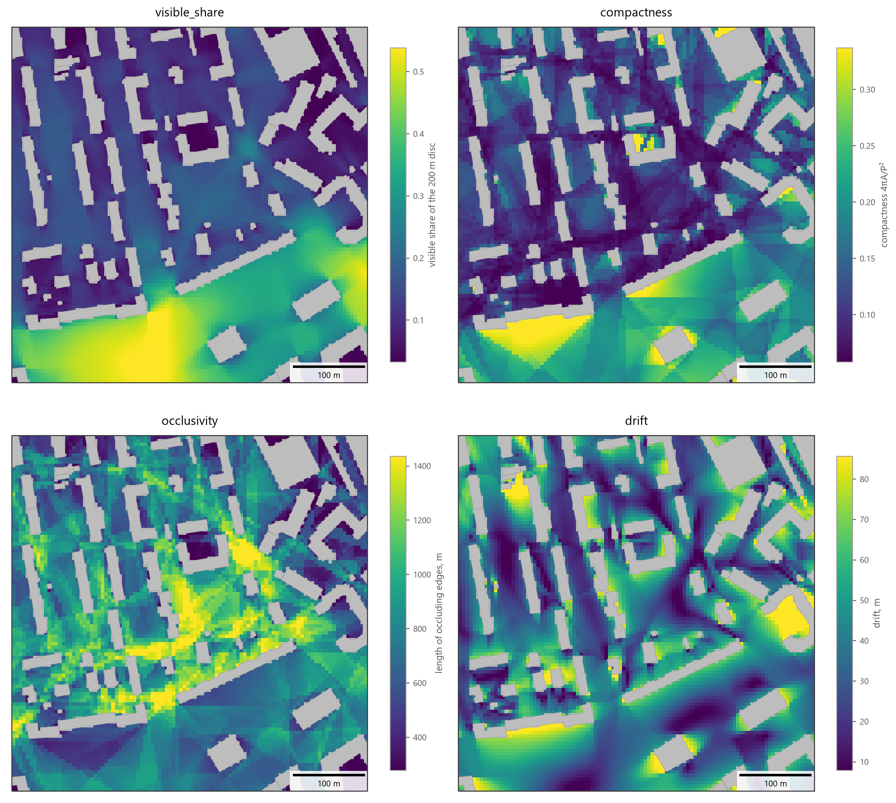
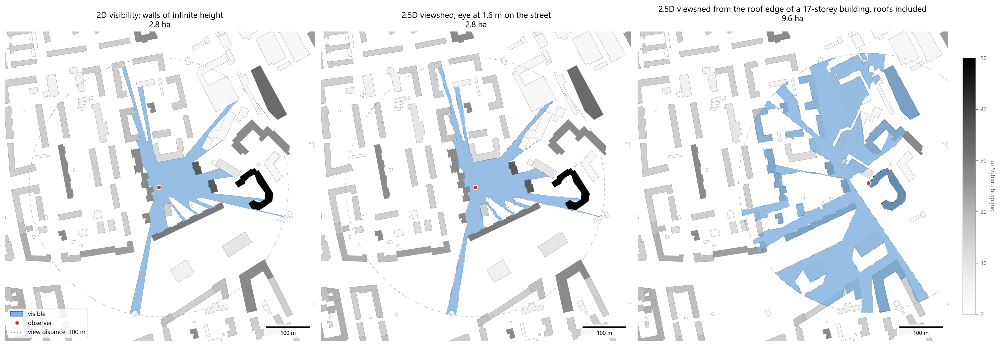
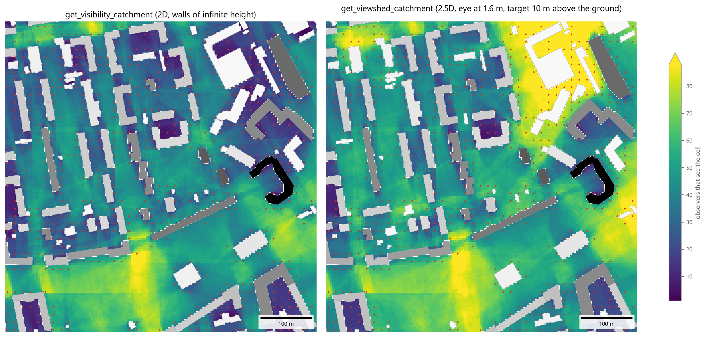

Visibility Analysis
===================

Overview
--------

Visibility analysis determines which parts of the urban space an **observer** can see and, aggregated over many
observers, how often each place is seen. ObjectNat provides two models:

- **2D visibility** (:func:`objectnat.get_visibility`, :func:`objectnat.get_isovist_grid`,
  :func:`objectnat.get_visibility_catchment`): every obstacle is a wall of infinite height. The result for one
  observer is its **visibility polygon** (isovist), a vector polygon whose boundary is computed exactly.
- **2.5D visibility** (:func:`objectnat.get_viewshed`, :func:`objectnat.get_viewshed_catchment`): buildings have
  heights, and terrain can raise the ground. The result for one observer is its **viewshed**, the grid cells to
  which the line of sight from the eye is clear, merged into one (Multi)Polygon per observer. Its outline follows
  the cells, so its accuracy is ``cell_size``.

The **catchment** functions count, for every cell of a grid, the observers that see it; the counts are drawn as a
raster. :func:`objectnat.get_observer_points` places observers along the
streets of an IduEdu graph. All calculations run in parallel threads in ObjectNat's Rust extension.

Grid results answer two different questions, and their values have different units. An **isovist field**
(:func:`objectnat.get_isovist_grid`) describes what an observer standing in each cell sees, for example the
visible share of the view disc: it looks out of the place. A **catchment** counts the observers that see each cell:
it looks at the place from the streets. Its unit is the number of observers (or the sum of their weights) in 2D and
in 2.5D alike. The middle of a large square has a high visible share, but a low catchment if few streets lead to
it.

2D visibility polygons
----------------------

Method
~~~~~~

:func:`objectnat.get_visibility` returns, for each observer, the part of the view disc (radius ``view_distance``
or the per-observer column ``visibility_distance``, in metres) that is not hidden behind obstacle walls. Obstacles
may be polygons (with holes) or lines. Observers and obstacles are reprojected to an estimated UTM zone. Obstacle
walls are clipped to the disc, every wall endpoint and wall intersection defines a critical direction, and one ray
per angular interval finds the nearest wall. The boundary is therefore exact; no rays are sampled at fixed angles.
Observers standing inside an obstacle get an empty polygon.

Isovist metrics
~~~~~~~~~~~~~~~

An isovist is the visibility polygon of one observer. With ``isovist_metrics=True``,
:func:`objectnat.get_visibility` describes every isovist with the measures below (Benedikt 1979; Turner et al.
2001; Batty 2001): how much the observer sees, what shape the visible area has and how much space is hidden behind
corners. Lengths are in metres and areas in square metres; observers inside an obstacle get ``NaN``.

The boundary of an isovist consists of three kinds of edges: the visible parts of walls, arcs of the **view
limit** (the circle of radius ``view_distance``) and **occluding edges**. An occluding edge lies on a line of sight
that passes a building corner. Beyond the corner the line of sight continues into space that the observer cannot
see, so the edge separates the visible area from a hidden one.

The examples in the table use a view distance R = 200 m and three simple places: an open field without obstacles,
the middle of a straight street 20 m wide between continuous walls, and a closed square courtyard 40 m wide.

.. list-table::
   :header-rows: 1
   :widths: 20 44 36

   * - Columns
     - What they measure
     - Examples
   * - ``area``, ``visible_share``
     - How much the observer sees: the area of the isovist, and this area divided by the area of the view disc,
       π R².
     - Open field: ``visible_share`` = 1. Street: a strip of about 20 × 400 m, so ``area`` ≈ 8,000 m² and
       ``visible_share`` ≈ 0.06.
   * - ``perimeter``, ``compactness``
     - The length of the isovist boundary, and 4πA/P², which compares the shape with a circle: 1 for a disc,
       close to 0 for a long narrow or spiky shape.
     - Open field: 1. Courtyard seen from inside: π/4 ≈ 0.79. Street: ≈ 0.14.
   * - ``n_occlusions``, ``occlusivity``
     - The number of occluding edges and their total length: how many corners the observer sees past, and how
       far the hidden space extends behind them.
     - Open field, street and courtyard: 0, since nothing is hidden. One building in an open field: two edges,
       the sides of its shadow. Crossings of narrow passages between buildings: high values.
   * - ``min_radial``, ``max_radial``
     - The distance from the observer to the nearest point of the boundary, usually the nearest wall, and the
       length of the longest line of sight.
     - Street: 10 m (the walls) and 200 m (along the street).
   * - ``mean_radial``, ``std_radial``, ``skew_radial``
     - The distance from the observer to the end of the view (a wall, an occluding edge or the view limit) over
       all directions: its mean, standard deviation and skewness. They are integrated exactly over each boundary
       edge.
     - Open field: mean 200 m, standard deviation 0. Street: mean ≈ 30 m and standard deviation ≈ 41 m; the
       skewness is positive, because a few long views along the street stand out among many short views to the
       walls.
   * - ``drift``
     - The distance from the observer to the centroid of the isovist: 0 when the visible area is balanced around
       the observer, large when most of it lies to one side.
     - Centre of the courtyard: 0. Next to the middle of one courtyard wall: 20 m.
   * - ``open_share``
     - The share of the boundary length that lies on the view limit, that is, on neither walls nor occluding
       edges.
     - Open field: 1. Courtyard: 0. Street: the two ends of the strip, 40 m of the 840 m boundary, ≈ 0.05.

The metrics add little time to the visibility calculation (about 0.8 s for 5,000 visibility polygons with 450,000
vertices in total).

.. autofunction:: objectnat.get_visibility

   Left: visibility polygon of one observer within 800 m among the example buildings. Right: three observers with
   ``visibility_distance`` 300, 500 and 800 m.

Isovist field
~~~~~~~~~~~~~

:func:`objectnat.get_isovist_grid` maps the metrics over an area. It places an observer at the centre of every
``cell_size`` cell of the area outside the obstacles, computes the exact isovist of each observer and its metrics,
and returns the observers as points with the metric columns. Obstacles outside the area but within
``view_distance`` of it still block the view. Every value is exact for its observer; the grid only sets where the
observers stand. :func:`objectnat.rasterize` turns any metric into a raster (see :doc:`rasters`), which shows for
every place what an observer standing there would see. Time is proportional to the number of observers: the field
below, 7,889 observers with a view distance of 200 m, takes 0.7 s.

The field has no edge effect: a value describes its own observer only, and buildings outside the area are taken
into account. For observers placed in another way, for example along the streets, compute the same metrics with
:func:`objectnat.get_visibility`:

.. code-block:: python

   from objectnat import get_observer_points, get_visibility

   observers = get_observer_points(walk_graph, spacing=15)            # a point every 15 m along the streets
   metrics = get_visibility(observers, buildings, view_distance=200, isovist_metrics=True)
   metrics.set_geometry(observers.geometry).plot(column="visible_share", markersize=4)

.. autofunction:: objectnat.get_isovist_grid

   ``get_isovist_grid(buildings, area, view_distance=200, cell_size=5)`` over a 500 × 500 m area (outlined) and
   :func:`objectnat.rasterize` of four metrics: the visible share of the 200 m disc, compactness 4πA/P², the total
   length of occluding edges and drift. Colour scales span the 2nd–98th percentiles. Most of the disc is in view
   in the open space in the south; compactness is high there and inside closed courtyards; occluding edges are
   longest where passages between buildings cross; drift is large next to walls that face open space.

2.5D viewsheds
--------------

Method
~~~~~~

:func:`objectnat.get_viewshed` uses building heights and terrain. The eye of an observer is ``observer_height``
(default 1.6 m) above the terrain or, for an observer inside a building footprint, above the roof. The area within
the view distance is divided into square cells of ``cell_size`` metres. A cell is visible when the straight line
from the eye to the cell centre at ``target_height`` above the ground (0 m for the ground surface, about 1.6 m for
people's faces) passes above every wall it crosses and above the terrain. Visible cells are merged into one
(Multi)Polygon per observer. With ``include_roofs=True`` cells on flat roofs are targets too, at the roof height.
Building heights and terrain are specified as for :func:`objectnat.get_insolation` (a height or storeys column; a
terrain GeoDataFrame, GeoTIFF or array), and the line-of-sight test shares its Rust implementation with
insolation.

The output keeps the index and attributes of the observers and adds ``visible_area`` (m²) and ``visible_share``,
the share of target cells within the view distance that are visible, the 2.5D counterpart of the isovist metric of
the same name. ``visibility_distance`` and ``observer_height``
columns override the arguments per observer. Computation time grows with ``(view_distance / cell_size) ** 2``
per observer.

For an observer on flat ground whose eye is lower than all surrounding buildings, the viewshed coincides with the
2D visibility polygon up to the cell size. The two differ where buildings are lower than the line of sight: from
a roof, from a hill, or when the target is above the ground (``target_height``).

.. autofunction:: objectnat.get_viewshed

   One observer on a street: 2D visibility polygon (left) and 2.5D viewshed at 1.6 m eye height (centre), both
   2.8 ha within 300 m (dotted circle). Right: an observer on the roof edge of a 17-storey building,
   ``include_roofs=True``; the viewshed covers 9.6 ha of ground and roofs. Grey shades show building height;
   ``cell_size=2``.

Visibility catchment
--------------------

Method
~~~~~~

:func:`objectnat.get_visibility_catchment` answers the question *from how many places is this place seen?* It
takes a set of observers, for example pedestrians every 15 m along the streets, and counts for every small piece of
the area how many of them can see it:

1. **Observers.** :func:`objectnat.get_observer_points` places them along the streets of a graph: it splits every
   street edge (on walk and intermodal graphs, every pedestrian edge) into pieces of about ``spacing`` metres and
   puts a point in the middle of each piece. Any points will do.
2. **Grid.** The area within ``view_distance`` of the observers is divided into square cells of ``cell_size``
   metres.
3. **Counting.** For every observer the visibility polygon is computed as in :func:`objectnat.get_visibility`, and
   every cell whose centre lies inside it gets one more observer (or the observer's weight from ``weight_column``,
   for example pedestrian flow). The value of a cell is therefore the number of observers that see it. The polygons
   are only counted, not returned, which keeps memory low.
4. **Result.** The cells that at least one observer sees are returned as points at the cell centres with their
   ``count`` (and ``weight``); cells inside buildings and cells nobody sees are left out.
   :func:`objectnat.rasterize` turns them back into the grid, a raster that shows the counts as a continuous
   colour scale.

For example, with observers every 15 m and a view distance of 250 m, a square that several streets open onto is seen
by a hundred observers or more, and a closed courtyard only by the few observers inside it.

**Place observers beyond the analysed area.** A cell near the edge of the area is also seen by observers outside
it, up to ``view_distance`` away. If the observers stop at the boundary of the area, the counts near the boundary
come out too low. Place observers over the area extended by ``view_distance`` and clip the result to the area.

Time and memory grow with the number of cells. Counts are in observers, so two areas or two scenarios with the
same observer spacing can be drawn on one colour scale. Visibility is symmetric, so the value of a cell is also the
number of observers visible from that cell.

:func:`objectnat.get_viewshed_catchment` is the 2.5D counterpart: a cell counts an observer when the line of sight
from the observer's eye to the cell target is clear, as in :func:`objectnat.get_viewshed`. Observers inside
building footprints are left out. Building footprints are rasterized once, and the lines of sight of all observers
are counted in the Rust extension. With ``include_roofs=True`` roof cells are counted too; roofs are seen from
street level only where the terrain or ``observer_height`` lifts the eye above them.

.. autofunction:: objectnat.get_visibility_catchment

.. autofunction:: objectnat.get_viewshed_catchment

.. autofunction:: objectnat.get_observer_points

   Number of observers that see each cell: 1,805 observers on open ground within 12 m of buildings, placed over the
   shown area extended by the view distance, ``view_distance=250``, ``cell_size=4``, the counts rasterized with
   :func:`objectnat.rasterize` on one colour scale. Left: 2D. Right: 2.5D with ``target_height=10``, the number of
   observers that see a point 10 m above the ground. Such a point is seen over buildings lower than the line of
   sight, so more observers see it.

Limitations
-----------

- 2D visibility ignores heights: low walls, fences and garages block the view as tall buildings do.
- 2.5D viewsheds use flat roofs and vertical walls; trees, street furniture and pitched roofs are not modelled.
  Results are discrete at ``cell_size``.
- Neither model accounts for atmospheric conditions, lighting or the visual acuity of the observer; a cell is
  visible if the geometric line of sight is clear within the view distance.

Example notebooks
-----------------

:doc:`examples/visibility` (2D visibility, isovist metrics, catchment) and :doc:`examples/viewshed` (2.5D
viewsheds and viewshed catchment).
